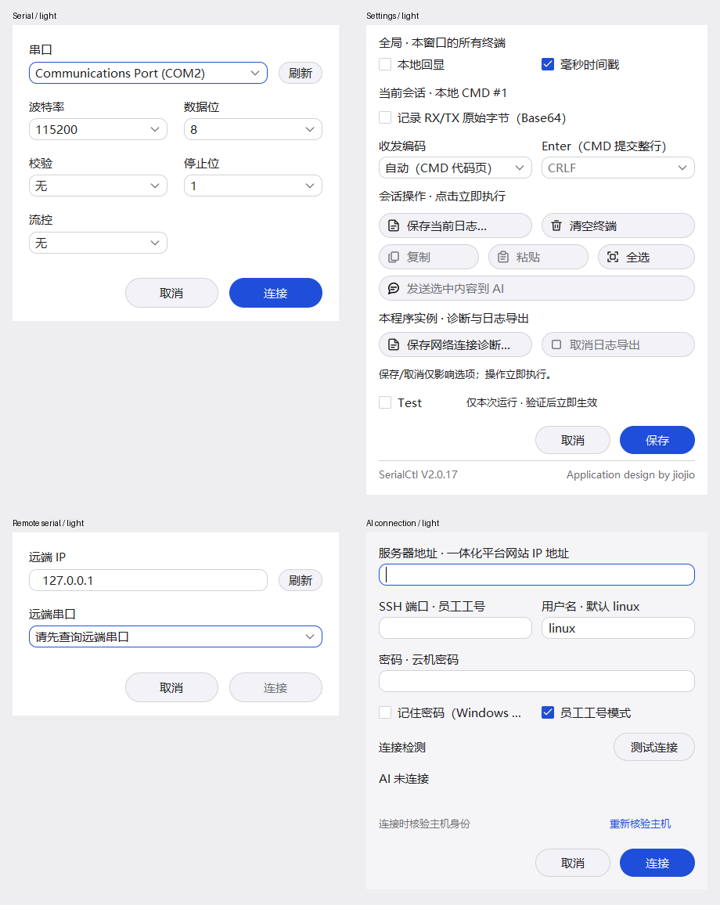
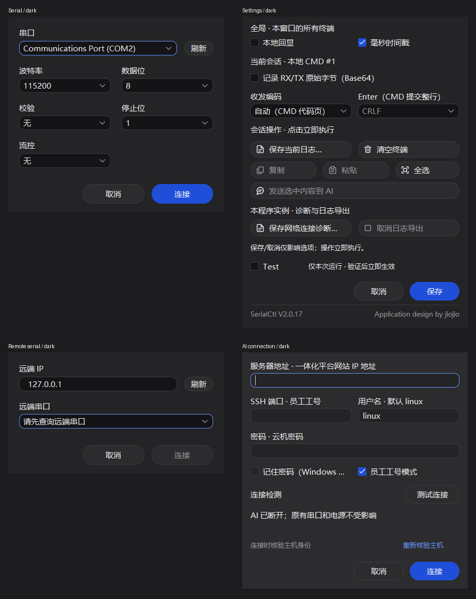

# V2.0.17 弹窗性能与稳定性审查

日期：2026-10-31—2026-11-01。正式基线为 main `5b950a3310d8f7b09b5771668af7cd5ef923b278`／V2.0.16。本报告区分源码诊断、完整候选包实测与正式发布门槛；诊断实验和参考 CI 不代替现场硬件验收。

## 目标与计时口径

保留 C++17／Win32、x64、Win7 SP1、静态运行库 `/MT`、子系统 6.01、现有控件、布局和操作行为。让串口、远程串口、AI 连接与设置弹窗达到同桌面 SSH 的响应水平。普通重复打开完整可操作首帧 P95 目标 ≤100ms，首次单列；原规格冷启动首次目标 ≤200ms。不能承诺任意低配置机器物理零延迟。

计时器通过真实系统鼠标打开生产弹窗，记录创建、可见、标题、完整初始子控件 GDI 绘制完成以及 WM_NULL 响应。GDI 标记不是 DWM／显示器呈现；GetTickCount64 有约 15.6ms 的量化，鼠标投递亦计入。每弹窗每主题 31 次，首次 1 次与后续 30 次分开；一次首次样本不称为冷启动 P95。AI 指连接设置表单；不将未测量的工作空间、历史或主机身份子弹窗混称为已达到相同指标。

性能对照在隔离账号禁用宠物，以排除顶层悬浮窗口遮挡；两版同条件。真实用户耐久及桌面交互保留宠物启用、可见，通过真实拖动放到主窗口外，不修改产品默认行为。

## 已确认的慢路径

串口有多组原生下拉字段，设置包含较多图标和操作；重复区域通知和整图着色的代价随控件数放大。SSH 表单在这些路径上的工作较少，因此原先明显更快。设备／网络查询已经后移后，首帧仍承担这些主线程布局和绘制，所以仅做异步查询不能消除剩余开销。

### 1. 下拉列表区域的同步通知反馈

`UiComboPopupProc(WM_SIZE/WM_WINDOWPOSCHANGED)` 调用 `UiComboRegion`，后者无条件 `SetWindowRgn`；该调用又同步发送窗口位置通知，形成重复进入。一次串口初始化观测到 RegionAll 2556 次调用，其独占时间约 130ms；嵌套包含时间约 2054ms，**不能将嵌套包含时间相加当成打开耗时**。

修复按实际尺寸和 DPI 记忆已应用区域，且在原生调用之前记录键，切断相同几何的同步反馈；真正尺寸或 DPI 改变仍更新区域。失败时按 Windows 所有权规则释放 HRGN，并在确认子类仍属原对象后撤销缓存。诊断中串口初始化约 127.7→8.7ms，区域独占约 130→0.94ms。

保持原生列表行高、挂接和几何初始化顺序。V2.0.12 的受控实验已证明，将这些操作全部推迟会损坏部分 DPI 的首次点击、top index 和键盘选择。最终回归检查真实鼠标、方向键、重建列表及 96/144/192 renderer scaling；这些缩放测试不是三个系统 DPI 实机验收。

### 2. 每个小图标都重新着色整张图集

原始 PNG 为 2592×96，包含 27 个 96×96 图标。每次 GDI+ 带 ColorMatrix 的 DrawImage 即使只选择一个图标，仍处理整张来源图。诊断串口 6 次图标绘制约 43.8ms，设置 10 次约 71.4ms，直接占用 UI 线程。

最终采用固定数量的原始切片缓存，保留两侧 8px 滤波保护区，沿用原始 ColorMatrix、HighQualityBicubic、PixelOffsetHighQuality 和 WrapMode。Save 图标的细线在 32px 对来源坐标取整更敏感，因此该图标保留原始整图绘制，其余图标使用切片缓存。缓存约 1.2MiB，与窗口数量、主题、颜色和重绘次数无关；失败退回原始绘制。不引入文件读取、后台 HWND 操作或新运行库。

像素回归扩展至 27 图标×4 尺寸（16/24/32/48）×5 颜色（含纯白勾选墨色）×2 背景×3 位置，共 3240 组合。基础 1944 组合已在正常候选上通过，扩展检查曾捕捉 Save 图标 32px 的 3/255 差异，保留其原始绘制路径而不提高 2/255 上限。最终定向检查 [41221466683](https://github.com/john2000smith7-del/SerialCtl/actions/runs/41221466683) 全部 3240 组合通过，最大差 2/255、超限通道为 0；100 次同尺寸区域更新没有额外位置通知，实际尺寸变化仍更新原生区域。在 Windows 原生对照中最大颜色通道差 2/255，来自 GDI+ 改变来源坐标后的滤波取整；不是逐像素完全一致。完整保留 artwork、着色与控件几何。无保护区切片曾产生 5/255 差异，预着色图集等实验也未采用。阈值明确限定为 2/255，并保留对照统计，不能用宽泛截图相似度遮盖错误图标或颜色。

### 3. 已排除的猜测

同桌面控制变量实验中，12–15 次背景缓冲回读合计 <0.3ms，字体度量亦 <0.3ms；不是百毫秒级主因。没有把这些试验性更换 DC／读回方式带入产品。

诊断组合试验的重复打开中位数约：串口 250→63ms，设置 156–172→47ms；SSH 约 47–78ms。该试验每组仅 5 个热样本且含诊断标志，属于根因证据，**不作为最终 P95 或发布验收数字**。

## 正常编译版本的完整采样对照

[Windows 对照运行 41219378587](https://github.com/john2000smith7-del/SerialCtl/actions/runs/41219378587)，候选源码 `59cdddb`，无诊断编译标志，与正式 V2.0.16 ZIP 在同桌面比较。每格以“浅／深”列示，单位 ms，P95 为 nearest-rank。该候选为临时 Runtime 安装目录，不当作正式发布包；任务最后的耐久步骤因旧夹具未准备足够桌面空间而失败，不能将整次任务标为成功，但下面四组计时及五项原生定向回归已完整结束，原始样本全部保留。

| 表单 | V2.0.16 首帧热 P95 | 候选首帧热 P50 | 候选首帧热 P95 | 候选首帧热最大 | 候选首次首帧 | 候选响应热 P95 |
|---|---:|---:|---:|---:|---:|---:|
| SSH 对照 | 79／78 | 62／47 | 78／63 | 79／78 | 63／47 | 79／79 |
| 串口 | 219／188 | 62／62 | 63／78 | 63／78 | 63／62 | 79／94 |
| 设置 | 156／141 | 47／62 | 63／63 | 63／63 | 78／79 | 78／79 |
| 远程串口 | 110／94 | 47／62 | 63／63 | 63／63 | 47／47 | 78／78 |
| AI 连接设置 | 78／63 | 62／47 | 63／63 | 78／63 | 47／63 | 79／78 |
| Telnet | 63／63 | 62／47 | 63／63 | 63／63 | 62／62 | 79／78 |

全部 744 个样本有效：两版本×两主题×六表单×31 次。候选四类目标首帧热 P95 63–78ms，消息响应热 P95 78–94ms，首次首帧 47–79ms，与 SSH 相同量级。正式包仍须独立运行同一计时器，不能以本表替代精确 main 发布包验证。完整原始 744 个样本及统计见 [normal-runtime-timing.json](../testing/results/V2.0.17-dialog-stability-20261031/normal-runtime-timing.json)。

## 完整候选 ZIP 的复测

对象：`1bb122aae8378906a54e6ebfe3bbc75eca00320d`，完整候选 ZIP SHA-256 `fea23d7c7507064c72824b5071e953dadd82a251158dc3733cc3b2b473b6e20b`。[Windows 运行 41221500270](https://github.com/john2000smith7-del/SerialCtl/actions/runs/41221500270) 已完成 scripts/release.ps1 内的源检查、干净 MSVC 构建、47 项 CTest、PE／Win7 导入检查、显式清单打包、压缩后复核及原生完整解包。

该运行随后完成全部性能采样，但自动统计因 PowerShell 5.1 的 UTF-16 日志编码停止，后续 GUI 步骤未执行，所以整条运行是失败状态，不能称为正式发布验收通过。解码修复后，对下载的**原始 UTF-16 日志**严格重算，744 个普通场景样本全部保留；两项 P95 门槛均满足 100ms。完整记录见 [verified-candidate-package-timing.json](../testing/results/V2.0.17-dialog-stability-20261031/verified-candidate-package-timing.json)。

下表为同桌面基线／完整候选包对照，“浅／深”，单位 ms；每格 P95 来自 30 个热样本，首次为单独一个样本。

| 表单 | V2.0.16 首帧热 P95 | 候选首帧热 P50 | 候选首帧热 P95 | 候选首帧热最大 | 候选首次首帧 | 候选响应热 P95 |
|---|---:|---:|---:|---:|---:|---:|
| SSH 对照 | 94／94 | 63／63 | 78／78 | 79／78 | 78／62 | 94／94 |
| 串口 | 235／250 | 78／78 | 79／79 | 79／94 | 63／78 | 94／94 |
| 设置 | 172／172 | 63／63 | 78／78 | 78／79 | 78／62 | 94／94 |
| 远程串口 | 94／94 | 47／47 | 63／63 | 63／63 | 47／62 | 78／78 |
| AI 连接设置 | 63／78 | 47／47 | 63／63 | 63／63 | 47／63 | 78／79 |
| Telnet | 63／63 | 47／47 | 63／63 | 63／78 | 62／63 | 79／79 |

这支持普通打开达到 SSH 同量级的结论；不把一次首次样本称为冷启动 P95，也不把这些数据推广成所有负载／机器的硬实时上限。持续 loopback Telnet 输出另有每表单两个样本，保留接收源字节进展和终端计数，不以小样本计算稳定 P95。

## 首轮 main 复测与发布拦截

main `6bacd371f877b677dc7f92a26358bca6c93dd7f8` 的 [完整 Windows 流程 41257530429](https://github.com/john2000smith7-del/SerialCtl/actions/runs/41257530429) 全部通过：47 项 CTest、ASan、744 个普通计时样本、界面／命令／更新启动／冻结对照，以及独立作业中的真实耐久。其 ZIP SHA-256 为 `d4a5262c1aeb6e516a9f3dfacf732be5f6219eef22bafbbdfb2d5b2f27124e82`。以下是该轮真实数据，不将其替换为前面候选的较好长尾。最终复核随后发现下文 SSH 尺寸映射释放竞态，**该轮 ZIP 已拦截发布；最终版须包含生命周期保护并重新验收，下载以文末发布页为准**。

| 表单 | 首帧热 P95 浅／深 | 响应热 P95 浅／深 | 单次首次首帧 浅／深 |
|---|---:|---:|---:|
| SSH | 78／78 | 94／94 | 78／62 |
| 串口 | 78／78 | 94／94 | 78／63 |
| 设置 | 78／79 | 94／94 | 63／78 |
| 远程串口 | 63／63 | 79／79 | 63／47 |
| AI 连接设置 | 63／63 | 79／79 | 63／63 |
| Telnet | 63／63 | 78／79 | 63／63 |

同桌面 V2.0.16 串口首帧热 P95 为 250／250ms、设置 172／172ms。普通场景绘制及响应均满足 100ms 的 P95 门槛，首次单样本仍不当作冷启动分位数或 DWM 呈现证明。

该轮真实耐久完成 60 次弹窗循环、289 次系统鼠标释放、38 次按住拖动（全部有 CMD 输出继续绘制）、40 次快速反向切换（最长 20.996ms）。两主题 FFV1 共 658 个采样／编码帧，无采样期限遗漏或编码队列丢帧；资源冷态→结束为句柄 265→314（热身后平台）、GDI 135→120、USER 198→199。有限测试退出码 0、关闭 0.042 秒，消息响应探针最长 49.233ms。

**持续 CMD 输出的辅助就绪观测仍有明显长尾**：SSH 110.197ms、串口 120.193ms、远程串口 101.540ms、设置 158.516ms、AI 122.263ms。这个口径包括系统鼠标投递及同步响应探测，和普通首帧 GDI 标记不同；它仍说明繁忙负载不能承诺每次小于 100ms。下一步应继续分解终端持续输出与弹窗绘制争用的 UI 时间预算，并与 SSH 同负载对照，不能仅换计时口径来宣称缺陷完全消除。已有强制重绘／DWM 调整试验未证明收益，不带入产品。

[该轮统计与资源摘要](../testing/results/V2.0.17-dialog-stability-20261031/first-main-verification.json)；[真实耐久小型证据](https://github.com/john2000smith7-del/SerialCtl/actions/runs/41257530429/artifacts/13064348672)。完整逐帧录像为该运行的 `SerialCtl-packaged-endurance`。本轮旧客户端升级检查虽通过，仍须对最终不同 ZIP 重新签名并重复验证。

## 网络尺寸通知阻塞布局

源码审查另发现：MainWindow::UpdateTerminalDimensions → QueuedConnection::ResizeTerminal 直接调用 TcpConnection::ResizeTerminal → SendWire。在 Telnet NAWS 已协商时，这条路径在 UI 线程等待发送互斥量／socket；连续拖动期间主窗已有暂缓终端重排，但结束拖动及其他布局更新仍可遇到阻塞，多会话会放大等待。

修复让 QueuedConnection 对可能阻塞的尺寸通知只在短锁内发布最新尺寸，由既有发送工作线程执行传输。每轮最多处理一次最新尺寸和一项 FIFO 输入，避免积累无界尺寸通知或饿死输入。连接接口明确区分可能阻塞的 wire 通知与独立通道：Telnet NAWS 进入发送队列，SSH 原有共享尺寸／事件通道继续立即送达，不能排在大块输入发送后等待。独立通道由 transport 保护资源寿命；不改变终端字节、PuTTY 格式或协议。队列回归另检查输入写入被持有时，独立尺寸通道已经收到最终值，停止后不再转发。

[受控阻塞对照 41220060847](https://github.com/john2000smith7-del/SerialCtl/actions/runs/41220060847)：同一原生 IConnection 探针，旧版连续 1,000 次尺寸调用在持有发送锁时耗时 1988.43ms；修复版合计 0.0184ms。先前尺寸通知自身被阻塞时，再提交 1,000 次耗时 0.0142ms。检查最终尺寸合并、A/B 字节顺序、Stop 不重放待发 C。这里约两秒是测试控制的阻塞时间，不冒称现场网络测量；另在 [41221466683](https://github.com/john2000smith7-del/SerialCtl/actions/runs/41221466683) 对真实 loopback Telnet NAWS 通过生产队列验证实际尺寸报文，同批阻塞回归再次通过（旧约 2000.23ms，修复后约 0.0148／0.0128ms）。

## 已确认并修复的内存安全问题

[独立通道输入准备持锁回归 41261207273](https://github.com/john2000smith7-del/SerialCtl/actions/runs/41261207273) 进一步确认：发送工作线程被持有时 1000 次独立尺寸更新 0.1228ms；另一输入调用已进入 PrepareInput 并持有发送队列锁时，1000 次仍为 0.1245ms。该即时分支只检查原子连接状态，由 transport 的生命周期锁处理与 Stop 的重叠，不等待输入准备锁。同批阻塞型入队 0.0172ms、先前尺寸阻塞时再提交 0.0167ms，实际 loopback NAWS、共享映射并发关闭及图标回归全部通过。正式主线还须按后文重新完成整体构建与交付门槛。

[最终尺寸通道定向回归 41260941668](https://github.com/john2000smith7-del/SerialCtl/actions/runs/41260941668) 验证保留独立通道的方案：受控阻塞下旧版 1000 次尺寸调用 1990.94ms，阻塞型通知入队后 0.0188ms；更早尺寸通知被阻塞时再提交 1000 次为 0.0210ms；输入被持有时独立尺寸通道 1000 次仅 0.136ms，且已收到最终值，不等待输入队列。真实 SSH 共享映射／关闭并发测试同批累计 9,512,848 次更新，最长关闭 125ms，热身后句柄 129→129、线程 4→4；这些是受控接口与子进程测试，不是现场 SSH 或物理硬件结果。

最终并发复核发现，在早期把尺寸通知统一改由发送线程转发的方案中，SSH 的 `ResizeTerminal` 可与后台 `Stop` 释放共享映射／事件重叠。原实现没有保护 `resizeState_` 的整个使用期，原子写入本身不能保护已解除的映射。这是源码确认的竞态，未把它称为已现场复现的崩溃。正式发布前增加独立的短生命周期互斥量，在完整尺寸写入／事件通知与解除映射／关闭事件之间同步；不等待 SSH 网络或管道 I/O，不更改 PuTTY 通道格式。生命周期回归持续发出真实映射更新并跨越关闭及关闭后状态，同时保留阻塞发送、关闭期限及句柄／线程回收检查。旧精确 main `6bacd37` 的 ZIP 因此只保留为上一轮验证对象，不作为最终发布文件；最终版本必须重新构建、计时、签名和升级验证。

[定向并发回归 41260621938](https://github.com/john2000smith7-del/SerialCtl/actions/runs/41260621938) 通过：1 次热身加 16 次循环累计 9,459,217 次实际 SSH 尺寸调用，保留不读输入／持续输出／回显三种受控子进程；关闭最长 125ms，热身后句柄 129→129、线程 4→4。关闭后仍继续调用并检查返回。这里使用受控 plink 子进程，不是现场 SSH 服务器，也不宣称旧竞态已经由现场崩溃复现；同批实际 loopback NAWS、发送队列及 3240 图标组合回归亦通过。

溢出视口 Scroll 逐个 SetWindowPos 时，原生子窗口回调可同步销毁父窗口，WM_NCDESTROY 随即释放视口；返回后继续迭代其 items_ 会访问已释放内存。受控原生回调在旧代码上触发 MSVC AddressSanitizer heap-use-after-free，位置为 UiDialogViewport::Scroll；不是只从源码推测，也不声称普通点击必然触发。

修复在原生调用后核对父窗口子类及对象身份，迭代项按值复制，失去所有权立即返回；Reset 在恢复几何前解除子类并由局部所有者保持对象生存期，避免同步销毁再次释放。滚动条绘制与布局收尾同样检查回调后的生存期。

- 旧代码复现：[41215680525](https://github.com/john2000smith7-del/SerialCtl/actions/runs/41215680525)。该诊断任务绿灯表示按预期复现错误，不表示旧产品通过。
- 修复对照：[41215845796](https://github.com/john2000smith7-del/SerialCtl/actions/runs/41215845796)，Scroll／Reset 均正常退出，无 ASan 报告。
- 常规 CTest 保留两种销毁回归；正式构建额外执行 ASan。它是 Windows 2022 原生内存测试，不是 Win7 上运行 ASan。

## 崩溃、卡死及无响应设计审查

| 位置／触发条件 | 结论与影响 | 处置／边界 |
|---|---|---|
| UiComboRegion 同步布局反馈 | 已确认 UI 线程浪费及深层重入 | 已修复，同尺寸更新必须不产生额外位置通知 |
| Telnet 已协商 NAWS，窗口布局通知遇到阻塞发送 | 已确认同步转发会阻塞尺寸调用方 | 已移到既有发送线程，受控阻塞／最终尺寸／FIFO／停止回归 |
| UiDialogViewport 子窗口回调销毁父窗口 | 已确认 heap-use-after-free，可崩溃 | 已修复，保留原生／ASan 双回归 |
| SSH 尺寸共享映射与后台 Stop 并发 | 源码确认映射使用与释放缺少同步；原子写入不保护映射寿命 | 发布前补充独立短锁，持续真实尺寸更新跨越关闭／关闭后，检查期限和资源回收 |
| BackgroundCleanup::Run 的 task()，QueuedConnection::Run 的 SendPrepared／ResizeTerminal／状态回调 | 工作线程无最终异常边界；若内部意外抛异常，会 std::terminate | 条件性风险，未证明日常设备错误会触发；现有传输多数返回错误码。后续应先定义异常后的断连与清理状态，再做故障注入，不应 catch 后伪称清理完成 |
| 发送队列在 PrepareInput／接受回调期间持锁 | 最大 8MiB 输入的准备、分配和回调仍可能延长排队等待；异步尺寸通知不等于硬实时无锁 | 条件性风险，未进行极端大输入同时缩放的专项注入；后续分离输入准备与发布顺序前须验证 FIFO／接受语义 |
| 工作线程创建失败、极端 GDI／内存资源耗尽 | 部分路径仍可能异常退出或进入同步回收退路 | 未做系统资源耗尽注入，不能声称覆盖；图标可选缓存分配失败已回退 |
| AI 展开历史重新排版 | 有 4MiB／2000 条显示上限及段落缓存，但宽度变化可使大量文字在 UI 线程重新度量；Poll 的 6ms 预算不限制单个 Reflow | 实测满量展开历史宽度变化约 329ms，仍是待优化的可感知停顿；不能把空白 AI 页面拖动等同满历史拖动 |
| 第三方串口／VISA／驱动调用永久阻塞 | 协议／发送超时不等于所有驱动调用都可取消；后台拥有线程可能使最后退出继续等待 | 真实驱动及硬件未验证。需要现场复现，再评估进程隔离；不随意 detach 持有对象的线程 |
| 关闭时后台工作仍在执行 | 已有取消、所有权保留、异步回收、重复 WM_CLOSE 防护及迟到消息清理 | 原生受控阻塞 transport 回归检查关闭处理返回、HWND 保持至回收完成；不能宣称永远有硬退出时限 |
| 设备发现／串口扫描结果晚到 | 已有对话框身份、generation 和窗口有效性检查，投递负载由所有者释放 | 回归取消／重开／销毁；未发现需移除现有保护的理由 |
| AI 事件暴涨、畸形协议、持续终端输出 | 已有事件数量／字节限额、异常诊断、溢出断连与分批处理 | 全量回归继续执行；不自动重放设备操作，不将截断当成完整数据 |

独立原生 AI 负载测量（`6dc2ad5`，2000 条展开文本，每条 1000 个 Latin 字符，约 4MB UTF-16）：

| 展开条数／UTF-16 字节 | 初次重排 | 同宽重排 | 原生窗口宽度 1000→700 |
|---|---:|---:|---:|
| 128／256000 | 19.65ms | 1.08ms | 23.81ms |
| 1000／2000000 | 138.09ms | 1.17ms | 170.17ms |
| 2000／4000000 | 272.31ms | 1.18ms | 329.16ms |

这证明宽度失效后的大量同步文字测量仍可能造成停顿；没有崩溃，也不是永久死锁。该数值来自受控原生窗体同步调用，不是实际鼠标到显示器的耗时。建议后续独立实现有预算的增量排版及可见区域优先，并验证选择、复制、滚动锚点和恢复历史。此次保持现有历史行为，不能将该风险写为已修复。

没有宣称已消除所有可能崩溃。条件性风险与已复现错误分开，未运行的故障注入不写成通过。

## 测试夹具与失败记录

- 一次完整构建在 46 项中有一项电源仿真断言失败：Action 与 State 分开读取，恰好跨过合法的十秒 OFF 期限，旧 phase 快照被错误用于要求新状态仍 OFF。修正测试的观察时间边界，同时保留 `onSubmittedAt-offConfirmedAt>=10000` 强校验；未更改电源生产逻辑或门控。
- 后续两次 47 项 CTest（原生 C++ 与 Python 协议集成）全部通过，但依赖检查在新内存探针处停止：该资产无关探针实际不导入 OLE32，初始依赖表却要求必须存在。依实际 PE 导入集修正该探针条目；生产程序的 API／DLL 兼容限制不变，失败构建不作为发布包。
- 完整候选包测量结束后，统计脚本因遗漏 PowerShell 5.1 默认 UTF-16 编码停止。修正为按 BOM 严格识别 UTF-16／UTF-8，并对原始日志重算；没有删除慢样本，也没有改变 100ms 双 P95 门槛。
- 新耐久夹具最初在 1024×768 的 hosted 桌面无法安置仍可见的宠物，立即停止。后续只在临时 GitHub-hosted 桌面设置并恢复分辨率，配置备份和还原均核验；没有隐藏宠物或取消命中检查来通过。
- 旧版持续输出与全桌面录像下，一次侧栏同点反向点击在 60ms 观察期限内未见目标标题变化，但后续真实截图已经展开。保留原证据，不称为丢点击。耐久记录每次释放到标题变化时间，最长观察 1 秒区分延迟／丢输入，同时要求每主题 20 次反向点击至少 90% 在 200ms 内变更。原有独立桌面审查继续运行。
- 修正后的夹具对正式 V2.0.16 完成一次基线耐久：60 次模态循环、289 次真实鼠标释放、610 帧 FFV1 录屏，两个主题均通过；这只证明夹具及旧版对照，**不充当优化版耐久结果**。

## 真实点击、拖动、缩放与资源耐久

[独立实测 41222577746](https://github.com/john2000smith7-del/SerialCtl/actions/runs/41222577746) 对上述同一完整候选 ZIP 运行真实系统鼠标输入，核对 PID、窗口命中、前台、实际控件状态及最终布局；没有以 WM_COMMAND 替代这些点击。生产源码与程序来自原生验证完成的固定构建，测试代码的提交另有回执。该独立任务通过，不因此改变其父构建因统计脚本失败的状态。

- 实际 Windows Server 2022 hosted 桌面，1920×1080、96 DPI；临时调整的显示模式与原配置均还原，命令文件字节未改。
- 60 次计入耐久的弹窗打开／取消循环（另有准备用 AI 表单），198 次助手计数的控件／背景点击，合计 289 次实际鼠标释放；两种主题均执行。
- 16 次按住标题拖动、16 次原生边框缩放、6 次侧栏分隔拖动；38 次按住期间都观察到真实 CMD 输出继续进入绘制。逐项检查主窗内容界限、终端最小区域、侧栏位置、最大化／还原和固定控件位置。
- 40 次快速反向切换（含同一坐标、落入双击时间内的输入）均变更目标状态，释放到目标标题变化的最大值 12.513ms；没有补发点击掩盖失败。
- 两段全桌面 FFV1 无损录像共 527 个采样／编码帧，零采样期限遗漏、零编码队列丢帧。实际时长约 32.54／33.21 秒；以 JSONL 时间为准，不能把名义帧率当作每帧真实均匀。
- 消息响应探针最大 37.077ms；正常退出码 0，关闭完成约 0.037 秒。这个退出时长属于无物理设备的有限测试，不是异常驱动下的硬退出承诺。
- 资源计数冷态→结束：GDI 135→121，USER 198→199，内核句柄 264→312。句柄主要在首轮类型／系统资源热身时增加，后续趋于平台；本次未见随循环持续增长，不能据此保证不存在任何泄漏。

持续 CMD 输出下，四类目标的观测就绪最大值分别为串口 82.749ms、远程串口 81.231ms、AI 84.821ms、设置 102.934ms。设置有一个超过 100ms 的样本，因此没有宣称所有负载下每一次打开都小于 100ms。该辅助口径包括真实点击投递、轮询及采样开销，不能和上表的 GDI 标记直接混算。

[详细动作、资源和录像索引](../testing/results/V2.0.17-dialog-stability-20261031/candidate-actual-user-endurance.json)；[小型原始截图／JSON 证据](https://github.com/john2000smith7-del/SerialCtl/actions/runs/41222577746/artifacts/13050238939)；完整逐帧录像保留在该运行的 `SerialCtl-endurance-native-candidate` 制品。

## 实际画面与首帧标记的区别

即时桌面截图曾捕捉到标题已出现、客户区仍为先前终端内容的一张过渡画面。为避免把 GDI 完成误写成显示器呈现，补做每表单三次、两主题的连续真实桌面采样：原路径、仅 GdiFlush、强制完整初始重绘、两者合并，以及关闭单个窗口过渡效果。

[重绘／提交对照 41223996230](https://github.com/john2000smith7-del/SerialCtl/actions/runs/41223996230) 和 [窗口过渡对照 41255926626](https://github.com/john2000smith7-del/SerialCtl/actions/runs/41255926626) 没有显示这些额外操作消除了首张采样的过渡；之后采样均为完整表单。窗口过渡 API 的关闭设置已在全部 30 次窗口上确认成功，仍未改善。实验性强制重绘、刷新和 DWM 修改均未带入产品。

采样本身每次实际可能花费约 26–47ms。一个深色 AI 示例中，第一张采样覆盖点击后 60.726–87.345ms，第二张覆盖 87.412–133.900ms，第二张表单完整；文件名中的“8ms”是请求间隔，不是已实现的采样分辨率。因此，本环境不能据这些截图严格证明物理显示器上的 100ms 上限，也不能把一张过渡图直接认定为长期缺画或卡死。冷启动且 CMD 刚开始输出的诊断还观察到首次长尾；普通热打开达标不能推广到任意冷启动。

以下为同一完整候选包的真实桌面稳定画面阅读裁剪，未重绘或缩放产品控件，**不是 100ms 呈现证明**；[原始文件、裁剪坐标及时间戳](../testing/results/V2.0.17-dialog-stability-20261031/actual-dialogs-provenance.json) 可核对。

稳定画面中未发现控件越界、操作行被遮挡或长期缺画。AI“记住密码（Windows 安全存储）”长说明沿用现有省略显示；没有为了性能重排该表单。像素冻结保持几何和图标外像素严格不变，仅对原有下拉箭头矩形及 1px 滤波边缘允许已验证的 2/255 差异；三阶差异和图标外一阶差异均由变异测试拒绝，不能扩大为整页颜色容差。

[界面对照复核 41257159462](https://github.com/john2000smith7-del/SerialCtl/actions/runs/41257159462) 通过：四项变异测试及深浅主题各六个视图的冻结比较均成功，所有控件几何一致，限定图标区域之外无意外像素差异。此前严格逐字节比较中，串口／远程串口／设置只因少量箭头像素不同而失败；保留原始失败数据，没有扩大整页豁免或更改产品颜色。主窗、各弹窗和隔离 SFTP UI 的完整 smoke，以及原生 Test 门控／电源连续滚动已在 [41255996566](https://github.com/john2000smith7-del/SerialCtl/actions/runs/41255996566) 的相应步骤通过；其整条任务当时因旧冻结比较规则失败，不记作全任务通过。

## 建议后续优先级

1. 优先对大 AI 历史做可见区域优先、分片布局；验收原文复制、选择、搜索和滚动锚点，不能靠丢失历史或仅画空白来压低时间。
2. 对后台 Stop、SendPrepared、ResizeTerminal 和通知回调做异常注入，明确失败状态及所有权回收后再增加异常边界；不能吞异常并继续声称连接／清理成功。
3. 补测最大输入准备和侧栏／窗口布局并发，检查队列锁等待；需要改动时保持接受顺序、输入来源记录与不重放行为。
4. 在真实 Win7／低配置机器、现场串口驱动、SSH／模型网关、板卡及电源上完成验收，再判断是否需要隔离不合作的驱动调用及设置退出上限。

## 正式交付门槛与核对入口

上述候选证据明确标注程序源码与测试运行。正式版本只从 main 生成，必须重新通过 scripts/build.ps1、test.ps1、check.ps1、release.ps1 所组织的完整 Windows 流程，包括 100ms 双 P95 门槛、实际界面与耐久，以及独立真实鼠标桌面审查。未把失败的候选流水线作为正式验收，也未把临时 Runtime 安装目录作为发布包。

正式下载以 [V2.0.17 发布页面](https://github.com/john2000smith7-del/SerialCtl/releases/tag/v2.0.17) 的源提交为准。发布工作流强制校验成功的 main 构建、精确 ZIP 与嵌入原身份签名的 update.json；另用原客户端 V2.0.16／V2.0.6 验证安装和重启。保留原公钥 SPKI SHA-256 `196b703ac1274da483936513794f0c03eb7be806c302db4d932b30378a78a21a`，私钥不上传 CI，不替换身份，不要求维护独立 .sig／files 目录。

未执行边界：真实 Windows 7 SP1、现场 SSH／AI 模型网关、物理串口板卡、电源、异常驱动永久阻塞、完整多屏／系统 DPI 矩阵及八小时硬件运行。PE 子系统／导入检查、模拟协议及 CI 桌面不能替代这些验收。
