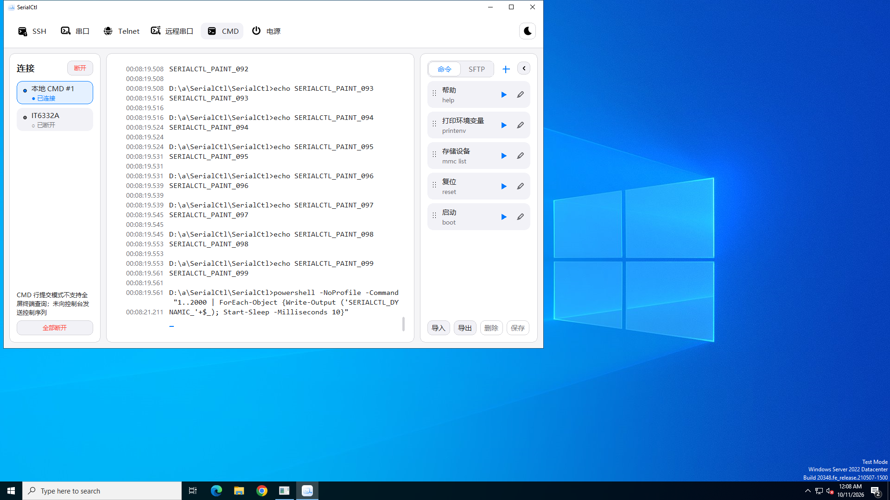
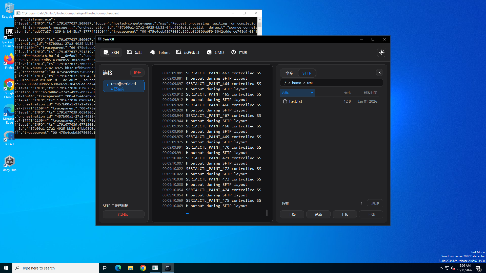
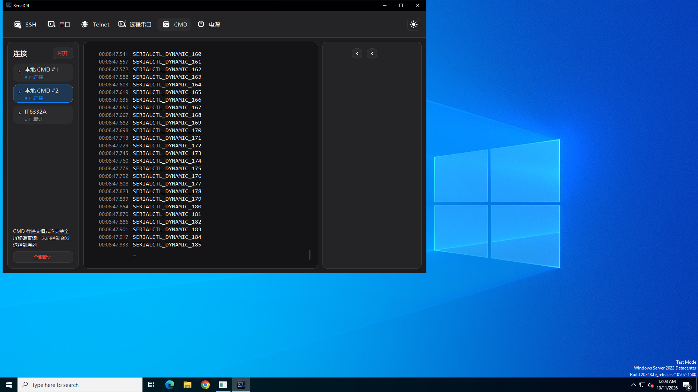
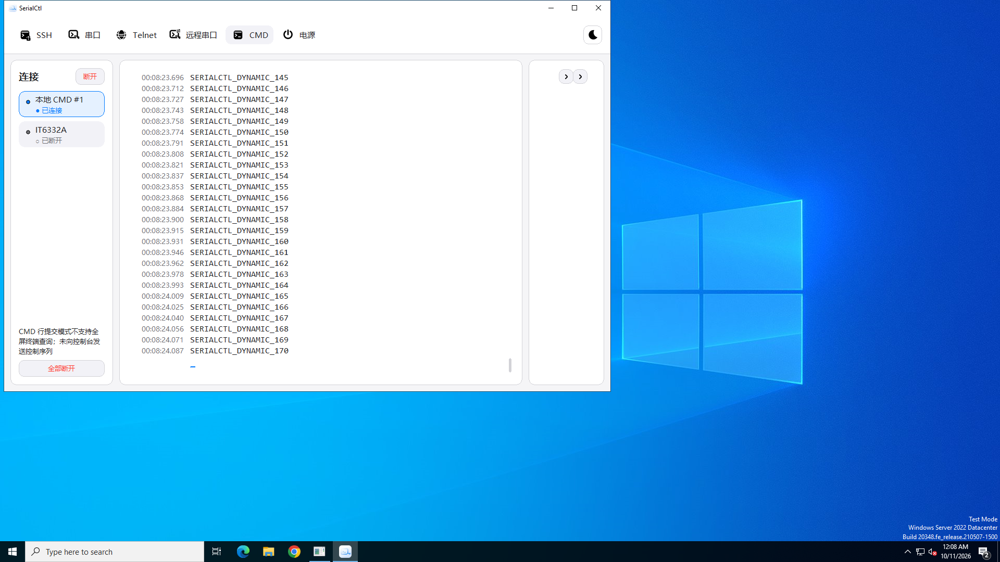

# SerialCtl V1.0.6 综合审核报告

> 仓库归档说明：本报告记录 2026-10-11 的审核，源码固定为 `5f12678e4da327f146edb5ce12eb3b3ea9c8afd0`。独立初稿中的阶段性限制及过宽表述，以统一报告与交叉复审裁定为准；仅修正导航链接，不把未运行项改为通过。完整 209 张图来自同次 Actions artifact，本仓库保留 17 张关键原图及全部文本证据，见 [证据索引](evidence/README.md)。

审核日期：2026-10-11 UTC。对象：原生 C++17/Win32 生产程序。结论由四个独立专业视角及交叉复审形成，具体分歧按证据处理，不投票。此次只读审核，未改生产实现、未合并 PR、未发布 Release。

**统一结论：修复分支已有可运行的统一会话/网络实现，正式构建和已有自动回归在本轮 Windows Server 2022 重新通过；仍存在应先修复的安全收尾、历史消息边界、终端自动响应、CMD 工作流及动画按钮重影缺口。不建议将当前版本标为“全部验收通过”。** Win7 SP1、实体串口/IT6332A、真实 SFTP/LAN、125/150/200% 系统 DPI、IME 和至少 8 小时现场稳定性均未运行。未提供“无漏洞”“无闪烁”或现场性能达标保证。

## 1. 版本、环境及程序身份

| 项目 | 核对结果 |
|---|---|
| 仓库 | https://github.com/john2000smith7-del/SerialCtl |
| 远端 main / 历史基线 | `0c70984b988c6236cf088ff2d4794f2ad3b8d278`，V1.0.5 |
| 远端修复分支 | `fix/unified-websocket-win7` |
| 实际审核完整 SHA | `5f12678e4da327f146edb5ce12eb3b3ea9c8afd0`，与用户交付提交完全相同；初次及交付前复核均没有后续提交 |
| VERSION | `PROJECT_VERSION=V1.0.6`；`CPP_VERSION=V1.0.6` |
| PR #1 | 核对时 open、未合并；不能把其临时 merge_commit_sha 当审核源码 |
| 独立目录 | `/workspace/serialctl-audit/source`，detached HEAD；原始 `/workspace` 非 Git 仓库；未覆盖其他工作 |
| 本轮 Windows 运行 | [38097145874](https://github.com/john2000smith7-del/SerialCtl/actions/runs/38097145874)，本审核主动触发现有 workflow，00:03:55–00:09:28 UTC，success；head SHA 与审核 SHA 相同 |
| 用户给定历史运行 | 38095158673 元数据确认同 SHA 且成功；本报告实测数值使用新运行，不复用旧文档统计 |
| Windows / 工具链 | Windows Server 2022 / 10.0.20348，VS 2022 Enterprise，MSVC 14.44.35207，Windows SDK 10.0.26100.0，x64 Release；4 逻辑 CPU、约16 GiB RAM，Intel Xeon Platinum 8573C |
| 桌面 | 1920×1080，96 DPI / 100%，浅/深主题；真实 Win32 窗口，非网页或重画界面 |
| 本地补充测试 | Linux x86_64、g++ 14.2.0、Python；生产 TerminalModel 原样编译及 ASan/UBSan，另有明确隔离层的源码抽取 harness |

源证据：[远端 refs](evidence/source/remote-refs.txt)、[源码 SHA](evidence/source/review-sha.txt)、[PR](evidence/source/pull-1.json)、[新运行](evidence/source/fresh-run.json)、[与基线差异](evidence/source/baseline-diffstat.txt)、[提交列表](evidence/source/baseline-commits.txt)、[Windows 环境](evidence/windows-fresh/ui/serialctl-ui/ui-environment.json)、[原始构建日志](evidence/windows-fresh/workflow-logs/0_build.txt)。按用户指定顺序读取 AGENTS、README、架构、UI 设计、构建和 testing 文档；实际结论继续追踪源码、测试断言和运行证据，未使用 legacy/csharp 推断生产行为。

本轮正式 ZIP：`SerialCtl-V1.0.6-Win7-x64.zip`，SHA-256：

```text
8bd51a23508600dba47b52132dad4741ff5dea316e7170cd28b51eb6b7af873d
```

本轮实际启动的 `serialctl.exe`（1,889,792 bytes）SHA-256：

```text
9c1cbc61715ef3b10a06675a0979488d7cb10b224018999fe78c8075253657b6
```

重新下载后核验：包内清单317项全部一致；三个生产 EXE 均 machine `0x8664`、PE 子系统 `6.01`，PuTTY 两个程序与固定源码输入哈希一致。[独立校验结果](evidence/windows-fresh/runtime-hashes.json)、[原始 MANIFEST](evidence/windows-fresh/runtime/MANIFEST.json)、[包内 SHA 清单](evidence/windows-fresh/runtime/SHA256SUMS.txt)。UI artifact ZIP 哈希 `ac204cae833f37fcaf43a38e43181f450752adb558dd0f85091a45fd8d30eef8`；portable artifact 外层 ZIP 哈希 `5c5d10a142a9adc8bee8092c91d3eabb9838082efe0dc274769a40a31283c5bd`，均与 GitHub 元数据一致，注意外层 artifact 与内层程序包是不同文件。

保留 `/MT`、YY-Thunks 1.2.1、固定 PuTTY 0.85/补丁/许可证和 NI-VISA 18 离线输入。无新增 .NET、ConPTY、WinHTTP WebSocket 生产依赖。NI 原始完整驱动介质包含其供应商组件，不把这些文件误判为 SerialCtl 新增运行库要求。导入黑名单与 PE 检查只证明所查静态条件，不能替代 Win7 启动/运行。

## 2. 四位独立结论与交叉裁定

| 独立审核者 | 独立结论及报告 | 交叉复审 |
|---|---|---|
| 软件工程与安全 | [01 安全独立报告](reports/01-security-independent.md)：满队列安全操作被拒、history envelope 超限；日志导出、握手 deadline 与 LAN 信任边界 | [05 安全交叉复审](reports/05-cross-security.md) |
| 架构 | [02 架构独立报告](reports/02-architecture-independent.md)：统一 SessionService/FIFO 确实落地；终端自动响应所有权不明确，UI 与数据处理仍有耦合 | [06 架构交叉复审及压力](reports/06-cross-architecture.md) |
| 产品 | [03 产品独立报告](reports/03-product-independent.md)：宏完成/停止语义不准、多行粘贴局部提交、后台错误丢失、电源清理告警候选 | [07 产品交叉复审](reports/07-cross-product.md) |
| 原生桌面交互 | [04 桌面独立报告](reports/04-desktop-independent.md)：键盘离开终端、DPI 宽度持久化、长模态及 smoke 断言缺口 | [08 真实截图与桌面交叉复审](reports/08-cross-desktop-visual.md) |

独立稿冻结在截图取回之前，故其中“截图尚未取得”等是阶段记录；最终状态以08和本报告为准。连接器随后成功取回完整209张原始 PNG 与 JSON/CTest，先前代理403记录保留为获取过程，不再作为最终证据缺口。审核执行曾因会话额度中断；独立稿已保存，续任同角色审核者在读取冻结稿后完成交叉复审，不伪称全程由四个连续不中断进程完成。

主要取舍：

- 接受满队列 OFF/stop/disconnect 拒绝、history 完整报文超限和 CMD 粘贴局部提交的实际受控复现；**不扩大**为实体电源危险动作已经发生或 Windows 实际设备数据已经丢失。
- 接受双模型终端自动回复与生产路由缺口；它是业务终端回复，不是 RFC 握手/Ping 字节泄漏。实体 UART 和双桌面端到端 TX 仍需补验。
- 日志 `condition_variable::wait` 等待时释放 mutex，修正独立稿“全程持锁”的过宽表述；但 GUI 同步等待、复制阶段持锁仍成立。磁盘无响应的无限挂起尚未复现。
- CMD 粘贴缺陷是活动草稿/光标被清空且前缀已提交；前缀历史和剪贴板可能帮助恢复，不称所有内容永久不可恢复。
- CMD 下 Shift+Tab/F6 走“不支持控制键”分支；SSH 等终端才发 VT 序列。键盘缺口是缺少到主操作区的明确焦点入口，不能一概说这些键会写入 CMD。
- `INADDR_ANY`、无认证且可操作已有 CMD 是既定信任模型的实际风险；任意 CMD 命令本就等同该用户 shell，不把它称为接口白名单“越权漏洞”。API 操作范围不是 OS 沙箱。
- 扩展视觉审阅找到浅色 animation-frame-8、深色 animation-frame-9 中的双折叠按钮反例，主审核又独立查看原图确认；项目8改为失败。不能由其他代表帧正常推断所有帧无闪烁，也不能仅凭截图定死擦除机制根因。系统96 DPI不能代替125/150/200%实测。没有投票式“多数同意即确诊”。
- F03影响应限定会请求近上限events的客户端；桌面常规subscribe逐事件回放，不能写成普通GUI必然触发该大报文。

## 3. 统一问题清单

P1：应优先阻止安全控制失败或非预期设备输入；P2：重要正确性、数据/状态、可用性缺口；P3：低风险文案。**源码确认**不等于真实窗口/硬件复现；**受控复现**明确所替代层。每条的完整触发、预期/实际、影响和回归在链接独立报告中，以下为统一裁定和修复入口。没有给未发生的缺陷伪造截图。

| ID / 严重度 / 定性 | 触发、预期与实际；源码行 | 证据、影响、修复与回归 |
|---|---|---|
| F01 / P1 / 已确认，受控实跑 | 电源 worker 不消费且队列128条 ON。预期安全 OFF/stop/disconnect 可抢先取消待执行加电；实际三者在优先级处理前均被容量检查拒绝。[src/power/PowerService.cpp:509](https://github.com/john2000smith7-del/SerialCtl/blob/5f12678e4da327f146edb5ce12eb3b3ea9c8afd0/src/power/PowerService.cpp#L509)、`:526` | [SEC-01](reports/01-security-independent.md)、[实跑 JSON](evidence/security/production-routines-result.json)。GUI/网络/全部断开均影响；先处理安全优先级或保留槽位，回归满队列、当前I/O阻塞、只关所属通道与断线unknown。不是正常 Shutdown 必然失败的证明。 |
| F02 / P1 / 代码路径与生产模型确认，端到端待补 | 同一COM本机和远端模型收到DSR/DA/尺寸查询；远端还会处理历史查询。预期共享终端自动回复有唯一所有者，历史不发新TX；实际 mode1/mode3都发送，且网格不同回复不同。[MainWindow.cpp:3932](https://github.com/john2000smith7-del/SerialCtl/blob/5f12678e4da327f146edb5ce12eb3b3ea9c8afd0/src/app/MainWindow.cpp#L3932)；[SharedSerialConnection.cpp:140](https://github.com/john2000smith7-del/SerialCtl/blob/5f12678e4da327f146edb5ce12eb3b3ea9c8afd0/src/connections/SharedSerialConnection.cpp#L140)、`:195` | [A-01](reports/02-architecture-independent.md)、[双模型日志](evidence/architecture/model-run.log)。打开远端查看可能额外向设备写入；服务端统一响应或明确单所有者，保留原始二进制，给回放加元信息；双桌面+两AI、不同尺寸与历史重放应只产生一次/零次TX。 |
| F03 / P2 / 已确认，受控实跑 | 合法events内部JSON131069 bytes、requestId128；预期完整响应≤131072或业务错误；实际加外壳后131309，公共Wire报Message too large。[ApiServer.cpp:592](https://github.com/john2000smith7-del/SerialCtl/blob/5f12678e4da327f146edb5ce12eb3b3ea9c8afd0/src/network/ApiServer.cpp#L592)、`:499`；[serialctl_ws.py:145](https://github.com/john2000smith7-del/SerialCtl/blob/5f12678e4da327f146edb5ce12eb3b3ea9c8afd0/tools/serialctl_ws.py#L145) | [SEC-02及生产函数 harness](reports/01-security-independent.md)。历史查询断开客户端；完整envelope序列化后限长，回归limit±1、最长ID、多字节元信息；不截断JSON或静默丢历史。 |
| F04 / P2 / 源码确认，GUI特测待补 | 慢CMD/设备宏最后一步刚入FIFO即“执行完成”；Stop只取消未来timer。[MainWindow.cpp:3777](https://github.com/john2000smith7-del/SerialCtl/blob/5f12678e4da327f146edb5ce12eb3b3ea9c8afd0/src/app/MainWindow.cpp#L3777)、`:3800`、`:3814`；[SessionService.cpp:113](https://github.com/john2000smith7-del/SerialCtl/blob/5f12678e4da327f146edb5ce12eb3b3ea9c8afd0/src/network/SessionService.cpp#L113) | [P-01](reports/03-product-independent.md)。会误判完成或已中断；改“已提交/停止后续提交”，用慢命令输出标记验收，不能把FIFO批次顺序写成任务互斥。 |
| F05 / P2 / 已确认，生产分支受控实跑 | 已有草稿，粘贴短完整行+8192字符尾行。先接受前缀、再清草稿、尾行失败。[MainWindow.cpp:4249](https://github.com/john2000smith7-del/SerialCtl/blob/5f12678e4da327f146edb5ce12eb3b3ea9c8afd0/src/app/MainWindow.cpp#L4249)；[CmdLineEditor.h:18](https://github.com/john2000smith7-del/SerialCtl/blob/5f12678e4da327f146edb5ce12eb3b3ea9c8afd0/src/terminal/CmdLineEditor.h#L18)、`:82` | [P-02](reports/03-product-independent.md)、[实跑日志](evidence/product/paste-tail-probe.log)。活动草稿丢失且整段重试可能重复执行前缀；先验证完整计划再提交，回归8190/8191/8192、CRLF、编码/发送失败、拒绝前TX=0及光标保持。 |
| F06 / P2 / 同步阻塞路径确认，故障影响候选 | 大日志导出至慢盘/网络路径。GUI同步SaveCopy并在复制时持logger锁。[MainWindow.cpp:4050](https://github.com/john2000smith7-del/SerialCtl/blob/5f12678e4da327f146edb5ce12eb3b3ea9c8afd0/src/app/MainWindow.cpp#L4050)；[SessionLogger.cpp:101](https://github.com/john2000smith7-del/SerialCtl/blob/5f12678e4da327f146edb5ce12eb3b3ea9c8afd0/src/logging/SessionLogger.cpp#L101)、`:126` | [SEC-03](reports/01-security-independent.md)、[交叉修正](reports/06-cross-architecture.md)。UI停处理可能触发4MiB接收上限后停transport；真实数据丢失/无限挂起未跑。后台快照导出、短锁、取消/进度；慢盘/磁盘满/只读注入和字节核对。 |
| F07 / P2 / 源码确认 | A后台失败、B激活，再切A；预期恢复A最后错误，实际仅日志保存且卡片只“已断开”。[MainWindow.cpp:2046](https://github.com/john2000smith7-del/SerialCtl/blob/5f12678e4da327f146edb5ce12eb3b3ea9c8afd0/src/app/MainWindow.cpp#L2046)、`:3567`；[MainWindow.h:82](https://github.com/john2000smith7-del/SerialCtl/blob/5f12678e4da327f146edb5ce12eb3b3ea9c8afd0/src/app/MainWindow.h#L82) | [P-04](reports/03-product-independent.md)。多会话排障断点；每会话保存lastError并刷新对应卡，32会话错误不能丢失或串用。颜色是否延迟另属候选。 |
| F08 / P2 / 源码确认，物理键盘特测待补 | 终端获取焦点后无法凭明确窗格快捷键到主导航/全部断开；多数主控件无WS_TABSTOP。[MainWindow.cpp:2180](https://github.com/john2000smith7-del/SerialCtl/blob/5f12678e4da327f146edb5ce12eb3b3ea9c8afd0/src/app/MainWindow.cpp#L2180)、`:2218`、`:1724` | [UI-01](reports/04-desktop-independent.md)、[语义修正](reports/07-cross-product.md)。鼠标受限用户无法完成主流程；补Tabstop及不向设备发送的窗格导航键，验证焦点与TX、两主题焦点环。 |
| F09 / P2 / 静态与算式复现确认，真DPI待补 | 高DPI宽屏保存>650物理像素侧栏，再同DPI重启。加载先按未缩放260–650限幅，保存的是物理值。[MainWindow.cpp:1766](https://github.com/john2000smith7-del/SerialCtl/blob/5f12678e4da327f146edb5ce12eb3b3ea9c8afd0/src/app/MainWindow.cpp#L1766)、`:2190`、`:4800`、`:4817` | [UI-02](reports/04-desktop-independent.md)、[算式结果](evidence/desktop/layout-model.json)。150%保存975后读成650；改96DPI逻辑单位并迁移旧配置，验收四DPI保存重启/跨DPI与SFTP列。 |
| F10 / P1候选 / 反馈链缺口确认，故障特测未跑 | 任务OFF/回读失败后“全部断开”：未保存action ID；Disconnect捕获错误后仍completed；断开后隐藏电源页。[MainWindow.cpp:3544](https://github.com/john2000smith7-del/SerialCtl/blob/5f12678e4da327f146edb5ce12eb3b3ea9c8afd0/src/app/MainWindow.cpp#L3544)、`:1742`；[PowerService.cpp:653](https://github.com/john2000smith7-del/SerialCtl/blob/5f12678e4da327f146edb5ce12eb3b3ea9c8afd0/src/power/PowerService.cpp#L653)、`:889` | [P-03](reports/03-product-independent.md)、[交叉复审](reports/05-cross-security.md)。不等于通道被伪写OFF（实际置null），但可能失去唯一持续告警；保存最终action、连接断开与掉电确认分开，受控超时+实体拔线验收。 |
| F11 / P2候选 / 未运行 | 高DPI/小工作区打开或逐步增加十步命令，动态高度无工作区上限/内容滚动。[MainWindow.cpp:6331](https://github.com/john2000smith7-del/SerialCtl/blob/5f12678e4da327f146edb5ce12eb3b3ea9c8afd0/src/app/MainWindow.cpp#L6331)、`:6389`、`:856` | [UI-03](reports/04-desktop-independent.md)。不能用DLU直接断言像素越界；真实144/192DPI测工作区和footer。保238DLU单列，固定footer、内部滚动。 |
| F12 / P2候选 / 代码缺少总deadline，Windows慢滴未跑 | 每<1.5秒补少量header。单次recv超时不断重置；128握手占满容量。[WebSocket.cpp:146](https://github.com/john2000smith7-del/SerialCtl/blob/5f12678e4da327f146edb5ce12eb3b3ea9c8afd0/src/network/WebSocket.cpp#L146)；[ApiServer.cpp:189](https://github.com/john2000smith7-del/SerialCtl/blob/5f12678e4da327f146edb5ce12eb3b3ea9c8afd0/src/network/ApiServer.cpp#L189) | [SEC-04](reports/01-security-independent.md)、[待执行探针](scripts/security_handshake_probe.py)。加绝对总deadline，检测槽位回收；不夸大为已实证新型DoS，正常128闲置连接也能占满既定容量。 |
| F13 / P3 / 源码确认 | 共享卡仍写“TCP 7000 · 共享”。[MainWindow.cpp:2772](https://github.com/john2000smith7-del/SerialCtl/blob/5f12678e4da327f146edb5ce12eb3b3ea9c8afd0/src/app/MainWindow.cpp#L2772)，而成功状态说WebSocket | [P-05](reports/03-product-independent.md)。旧用户可能尝试已移除原始TCP；改WebSocket文案并双主题检查裁字；不是旧TCP入口仍存在。 |
| F14 / P2 / 本轮真实桌面帧已观察，根因候选 | 持续CMD输出时快速反向展开/收起，个别中间帧出现两个同向折叠按钮。浅色frame-8约x1073–1128、深色frame-9约x969–1037，y133–161；相邻帧单个。代码只创建一个toggle，动画仍显示并移动。[MainWindow.cpp:2237](https://github.com/john2000smith7-del/SerialCtl/blob/5f12678e4da327f146edb5ce12eb3b3ea9c8afd0/src/app/MainWindow.cpp#L2237)、`:2337`、`:2407`、`:4854`；[UiStyle.h:274](https://github.com/john2000smith7-del/SerialCtl/blob/5f12678e4da327f146edb5ce12eb3b3ea9c8afd0/src/app/UiStyle.h#L274) | [UI-V02与对照原图](reports/08-cross-desktop-visual.md)。确认短暂重影/重绘不同步，不声称永久重影或已定位唯一根因。将toggle固定在稳定绘制层或统一旧/新区域失效与绘制提交，保持现有200ms动画；两主题持续输出、反向100次、桌面连续录像及帧时间验收。 |
| F15 / P3 / 原图与源码确认 | 十步上限“添加指令”已EnableWindow(false)但仍蓝色可用外观。[MainWindow.cpp:6384](https://github.com/john2000smith7-del/SerialCtl/blob/5f12678e4da327f146edb5ce12eb3b3ea9c8afd0/src/app/MainWindow.cpp#L6384)、`:2708` | [UI-V01](reports/08-cross-desktop-visual.md)、[深色十步原图](evidence/windows-fresh/ui/serialctl-ui/x64-dark-macro-ten.png)。无效点击反馈不清；加号专用绘制遵守统一disabled token，两主题1/9/10步状态回归，不改窗口布局。 |

测试可信度另记：现有日志测试证明增长、分卷、复制和源路径保护，但未发现磁盘满/WriteFile/Flush失败注入；文档“磁盘失败测试通过”应收窄。模态保存的前台断言不能证明取消、后台关闭、owner链与焦点全矩阵。列宽变动不等于重启持久化通过。详见01、04、08。

## 4. 用户12项重点核实矩阵

“通过”只在明确的本轮受控范围内；“部分通过”表示已有正向证据同时有未运行边界；“失败”表示存在明确反例，不表示整项功能都不可用。

| 项 | 结论 | 本轮证据与限制 |
|---|---|---|
| 1 统一协议/旧入口/控制字节 | 通过（受控入口范围） | 一个`/serialctl`、`serialctl.v1`外部业务入口，远端桌面/Python共用；GUI本地直接进同一SessionService，不绕回WebSocket。旧TCP/REST/SERIALCTL握手拒绝且替身TX=0；SSH/Telnet向外客户端仍保留。F02终端响应是不同层的问题。[协议CTest](evidence/windows-fresh/ui/serialctl-ui/ctest-x64.txt)、[01/02源码](reports/02-architecture-independent.md) |
| 2 多用户、多COM、准确错误、批次 | 部分通过 | 受控COM3两AI+生产桌面客户端、COM5隔离、资源消失/占用/实例歧义/129th容量拒绝，FIFO整批不交叉；F02自动响应所有权缺口。实体UART/LAN未运行。128是容量，不是已测持续负载。 |
| 3 RFC6455/全字节/分片等 | 失败（长度反例） | 掩码、长度、分片、粘包、Ping/Pong/Close、非法帧、0–255、NUL/FF/CRLF、握手后首包受控测试通过；F03完整响应超限失败。更多RFC负向矩阵及F12慢滴握手未跑；没有过滤合法二进制。 |
| 4 事件、独立有界队列、慢端与回收 | 部分通过 | CV唤醒，客户端4MiB/4096条、输入8MiB、历史每资源1MiB/1024及总16MiB。慢端隔离健康端9,830,400 bytes核对无丢失；1/2/8/32线程句柄回收。Publish同步编码复制与UI溢出耦合仍需场景测试，8h未跑。 |
| 5 CMD编辑/执行/编码/状态 | 失败（特定粘贴/语义） | 两主题逐键消息、方向/删退/HomeEnd/历史、UTF8/GBK实际stdout、set/cd、CRLF、长命令与异步草稿已有断言；F04/F05失败。Ctrl+C、全屏交互明确不支持；IME/真Win7未跑。消息级键盘不是完整物理键盘/IME验收。 |
| 6 终端空行/重排/历史/备用屏 | 部分通过 | CTest+本地生产模型/ASan/UBSan通过，包括空行、软硬换行、宽字符/颜色/光标/锚点和满缓存缩放；备用屏单独VT网格。真实终端字体/复杂远端交互与全选择矩阵未跑；不将普通日志重排结果代替备用屏。 |
| 7 主动输入回实时/后台保留阅读 | 通过（本轮GUI断言范围） | 两主题JSON明确后台logical anchor保持、active typing/Enter follow latest；执行/粘贴同一源码发送路径。真硬件及IME输入仍无覆盖。[浅色](evidence/windows-fresh/ui/serialctl-ui/x64-light-display.json)、[深色](evidence/windows-fresh/ui/serialctl-ui/x64-dark-display.json) |
| 8 拖动/反向动画/SFTP/电源分页 | 失败（动画帧反例） | 实际鼠标、窗口尺寸/分页操作、209PNG含CopyFromScreen中间帧；F14在两主题反向动画帧观察到双按钮，详见08。SFTP是受控进程替身，电源无设备；其他代表帧正常不能抵消此反例或证明全程无闪烁。 |
| 9 加号/中文/多DPI/多连接滚动 | 部分通过 | 96DPI两主题图标/中文代表帧；35真实CMD的顶部锚点、选择、滚轮/按键/滑块有断言。125/150/200%未运行，F09宽度恢复问题与F08键盘入口仍在。 |
| 10 全部断开/任务/正常退出 | 失败（安全容量边界） | 35真实CMD及已记录子树收尾0.375秒，无残留；普通退出及受控power测试通过。F01满队列停止拒绝，F10掉电告警候选。真实UART释放、SFTP取消、实体电源任务未验收；失联不能称成功掉电。 |
| 11 模态owner/焦点/层级 | 部分通过 | 真实Notepad遮挡后保存主窗前台断言及截图，源码仅一次条件恢复；未见主窗全局置顶/绘制抢前台路径。取消、后台关闭、owner链与焦点细节、Win7尚未全验。 |
| 12 AI范围/非法参数/未知资源/不重发 | 部分通过 | 白名单仅已有本地serial/CMD及电源查询/GUI所选通道总ON/OFF和action；不开放建连/断连/参数/SSH/SFTP/SCPI/任务等；负向测试含副作用计数为0、合法输入与去重，客户端断线不自动重发。既定无认证LAN暴露需部署限制；F01/F03边界未因scope测试通过而消失。 |

## 5. 实际窗口操作与视觉证据

本轮由审核主动启动现有 Windows workflow：[release.ps1](https://github.com/john2000smith7-del/SerialCtl/blob/5f12678e4da327f146edb5ce12eb3b3ea9c8afd0/scripts/release.ps1)执行SourceOnly→clean x64 build→test→PE检查→白名单打包→重开校验；随后运行`cmd_pipe_encoding_probe.py`、[smoke-ui.ps1](https://github.com/john2000smith7-del/SerialCtl/blob/5f12678e4da327f146edb5ce12eb3b3ea9c8afd0/scripts/smoke-ui.ps1)和Python客户端测试。脚本操作真实 HWND，包含实际鼠标移动/按下/释放、真实CMD子进程和stdout核对。部分按钮/按键采用Win32消息自动化，不声称每个操作都来自物理键盘。

原始截图：完整209张保留于同次 Actions artifact；[本仓库证据目录](evidence/windows-fresh/ui/serialctl-ui/)保留17张关键原图，完整下载与到期时间见[证据索引](evidence/README.md)。桌面专家逐文件观察清单在[08](reports/08-cross-desktop-visual.md)；主审核另查看浅色drag-frame-0、深色sftp-column-frame-4、两张动画反例及深色十步原图。PrintWindow布局图与CopyFromScreen桌面图分开，未用生成图、网页仿真、重绘或图片拉伸替代。

| 实际操作 | 支持的结论 | 仍缺的证明 |
|---|---|---|
| 双主题、980×620、最大化/恢复、连续窗口/侧栏调整 | HWND几何与烟测通过；F14两主题中间帧出现双按钮，动态视觉不通过 | 多DPI/Win7及重影根因/发生率 |
| 持续CMD输出、逐键编辑、中文编码、粘贴、历史阅读 | 实际stdout标记、日志与绘制测点 | IME候选/物理键盘、F05边界GUI复现 |
| SFTP列宽真实鼠标拖动、收起/展开、SSH替身持续输出 | 实际控件路径、列宽改变、stdout绘制、10中间帧/主题 | 真SSH服务器/数据传输/重启持久宽度 |
| 电源分页快速切换、模式/连接/任务弹窗 | 真实窗口及代表图；未连接读数应为未知 | 真监测刷新同时编辑、输出/任务硬件结果 |
| 35CMD连接滚动、选择、刷新、全部断开 | 子树退出、顶部/选择锚点等实际断言 | 32实体连接、SFTP/电源全收尾 |
| 命令编辑保存/取消及Notepad遮挡 | 保存前台与对话框路径、代表布局图 | 完整owner/focus/z-order矩阵、Win7现场 |









## 6. 压力、延迟与资源数据

原始[CTest stdout](evidence/windows-fresh/ui/serialctl-ui/ctest-x64.txt)、[提取CSV](evidence/architecture/fresh-stress.csv)。Windows2022、回环TCP、两路受控COM；实际UART速率不适用。每轮1000个64-byte发布批次，各客户端逐个接收；样本数为客户端数×1000。起点为Publish调用前QPC，终点为对应客户端完整Receive及字节解码校验后QPC，包含串行遍历客户端开销，不包含物理UART/真实LAN/UI绘制。CPU是累计进程CPU毫秒，不是CPU百分比。

| 客户端 | P50 / P95 / P99 ms | 校验输出bytes | wall / CPU ms | 工作集bytes | 线程 idle→active→回收 | 句柄 idle→active→回收 |
|---:|---|---:|---|---:|---|---|
| 1 | 0.0641 / 0.0827 / 0.1106 | 64,000 | 69.0557 / 93.75 | 8,986,624 | 8→13→8 | 119→138→119 |
| 2 | 0.0888 / 0.1038 / 0.1220 | 128,000 | 97.9975 / 109.375 | 9,097,216 | 8→15→8 | 119→149→119 |
| 8 | 0.1120 / 0.1541 / 0.1673 | 512,000 | 153.648 / 343.75 | 9,453,568 | 8→27→8 | 119→215→119 |
| 32 | 0.3588 / 0.5871 / 0.6674 | 2,048,000 | 549.267 / 1031.25 | 11,132,928 | 8→75→8 | 119→479→119 |

另一个慢客户端测试：健康端9,830,400 bytes逐字节一致；停读端被隔离。线程/句柄是在测试轮次观察点回到基线，不证明8小时无泄漏。队列配置上限从源码确认；**未连续采集每个队列的高水位/排空曲线**，不补造统计。

显示单独测量：真实CMD、1客户端、每主题100样本。起点为组成完整唯一stdout标记的合并UI批次首个PostData QPC，终点为首次实际终端BitBlt绘出标记。排除更早碎片、命令执行前段和DWM/显示器物理呈现。

| 主题 | P50 / P95 / P99 ms | 原始样本 |
|---|---|---|
| 浅色 | 5.597 / 6.686 / 8.451 | [JSON](evidence/windows-fresh/ui/serialctl-ui/x64-light-display.json) |
| 深色 | 5.283 / 6.154 / 6.619 | [JSON](evidence/windows-fresh/ui/serialctl-ui/x64-dark-display.json) |

全部断开35个真实CMD：0.375s，`children_after={}`且已记录子进程全部退出，见[gui-lifecycle.json](evidence/windows-fresh/ui/serialctl-ui/gui-lifecycle.json)。这是本轮短时负载，不把128连接容量、1秒内转发短测或2022显示统计转写为现场性能承诺。频繁连接/关闭、合法持续发送及受控资源消失在测试中执行；真实网络断线、物理拔插、磁盘满、8小时未运行。

## 7. 架构与产品实施路线

| 顺序 | 工作及用户收益 | 代价、依赖、风险及验收 |
|---|---|---|
| 立即修复 | F01安全控制优先级；F02终端回复唯一所有者；F03完整消息限长 | 中等成本，跨power/API/session，但保持v1与Win7。重点回归排队取消、回放不发TX、旧客户端互通，不能以过滤合法FF掩盖问题。F02先补双桌面受控TX特测。 |
| 立即修复 | F04准确提交/停止文案；F05完整粘贴预检 | 低至中成本，减少误操作/重复执行；保留现有命令卡和行编辑器。验收失败不改变草稿、无前缀副作用，不新增自动重发。 |
| 立即核实 | F10断连后掉电unknown持续反馈 | 需故障注入，中成本；连接断开与输出确认分状态，保留action/受影响通道，不能开放网络断连或任务权限。 |
| 近期优化 | F14动画按钮绘制同步、F15禁用视觉；日志快照后台导出；每会话错误状态；焦点窗格导航；DPI逻辑尺寸；超高命令编辑内容滚动 | 低至中成本，收益为持续输出可用、排障与键盘/高DPI任务完整。注意文件快照一致性、旧设置迁移和键盘不误写设备。按现有UI指南浅/深主题/黑白导航/覆盖滚动条实施。 |
| 近期验证 | 补慢握手总deadline、磁盘失败注入、完整RFC负向边界与GUI断言有效性 | 低至中成本；防误判通过。将已存在的文字/窗口存在断言补为状态/字节/owner/保存恢复结果断言。 |
| 后续规划 | SessionHub逐步从MainWindow抽出注册、原始输出分发、解码/日志调度；Publish锁内仅维护顺序/快照，外部分发 | 中至高成本；先测热点/队列再改，避免破坏历史→实时顺序与设备单读写。无需新增REST/微服务/ConPTY/.NET。 |
| 后续按明确需求 | 可选写租约/任务完成协议；部署来源限制及非可信网鉴权/加密 | 需产品权限决策与协议兼容设计；默认v1语义保持，断线未知不重发。认证若新增必须评估Win7和无新运行库约束。 |

部署事实：自动监听全部IPv4接口，任何网络可达客户端可读写既有串口/CMD；CMD具有进程用户权限。上线到可信实验网前应限制7000–7015来源主机/接口，并明确浏览器Origin风险尚未做利用验证。没有把实例ID当凭证，没有建议扩大AI到SSH/SFTP/SCPI/自动化任务。

## 8. 验收边界及可执行交接

[完整人工验收表](reports/09-manual-acceptance.md)提供Win7、四DPI、真实UART/IT6332A/SFTP/LAN、磁盘故障及8小时步骤、预期结果和证据字段；[源码原人工步骤](https://github.com/john2000smith7-del/SerialCtl/blob/5f12678e4da327f146edb5ce12eb3b3ea9c8afd0/docs/testing/MANUAL-REGRESSION.md)与[Win7硬件步骤](https://github.com/john2000smith7-del/SerialCtl/blob/5f12678e4da327f146edb5ce12eb3b3ea9c8afd0/docs/testing/WIN7-HARDWARE-TEST.md)一并保留。没有相应环境就填写“未运行”，不能用模型或旧成功构建替代。

审核补充脚本在[scripts](scripts/)：原样生产方法提取与边界复现、终端双模型、DPI公式、本地模型与ASan/UBSan。完整Windows自动化仍在[source/scripts/smoke-ui.ps1](https://github.com/john2000smith7-del/SerialCtl/blob/5f12678e4da327f146edb5ce12eb3b3ea9c8afd0/scripts/smoke-ui.ps1)和[source/tests/integration](https://github.com/john2000smith7-del/SerialCtl/blob/5f12678e4da327f146edb5ce12eb3b3ea9c8afd0/tests/integration/)，与实际执行SHA匹配。根目录CMake在Linux不构建Windows应用；一次SFTP模型直接Linux编译因windows.h缺失而停止，保留失败日志但不计为产品失败。

原完整交付包包含独立与交叉报告、源码快照、原始日志/JSON、209 PNG、复现脚本、压力CSV、程序身份与校验清单。本次仓库归档保留报告、文本证据、复现脚本及17张关键原图，以固定SHA链接源码；不提交147MB ZIP、生产EXE或驱动介质。未归档PNG和正式程序包可从同次Actions运行获取，注意保留期限。没有把受控SFTP替身放入正式运行包。
