# SerialCtl 用户操作手册

**适用版本：V2.0.5 · 图解操作版**

本手册使用 V2.0.5 的真实 Windows 运行截图。图中的 IP、账号、设备名、日志和 AI 对话是操作演示内容，请替换为现场信息。蓝色方框与箭头用于定位，编号与对应操作步骤配合阅读。

PDF 可直接打开；离线阅读 Markdown 时，请保持本文件与 `images` 文件夹在同一目录。需要查看界面小字时，可以放大 PDF 或打开对应 PNG。

## 目录

- [01　启动与界面导航](#chapter-01)
- [02　切换会话与断开连接](#chapter-02)
- [03　连接本地串口](#chapter-03)
- [04　连接远程共享串口](#chapter-04)
- [05　SSH 登录与主机身份核对](#chapter-05)
- [06　连接 Telnet](#chapter-06)
- [07　使用本地 CMD](#chapter-07)
- [08　终端输入、复制与历史查看](#chapter-08)
- [09　常用命令：运行、编辑与保存](#chapter-09)
- [10　多步命令与停止后续步骤](#chapter-10)
- [11　SFTP 文件浏览与传输](#chapter-11)
- [12　设置：回显、时间戳、编码与换行](#chapter-12)
- [13　保存日志与导出诊断](#chapter-13)
- [14　连接 AI 服务器](#chapter-14)
- [15　让 AI 分析日志并执行诊断](#chapter-15)
- [16　AI 实时终端与长行查看](#chapter-16)
- [17　AI 过程折叠、历史会话与整理](#chapter-17)
- [18　让 AI 处理服务器项目](#chapter-18)
- [19　主题与面板布局](#chapter-19)
- [20　启动在线更新](#chapter-20)
- [21　电源页面：当前版本状态](#chapter-21)
- [附录 A：常用操作速查](#appendix-a)
- [附录 B：常见问题](#appendix-b)

<a id="chapter-01"></a>

## 01　启动与界面导航

完整解压发布 ZIP 后，双击 serialctl.exe。serialctl.exe、plink.exe 和 psftp.exe 应保留在同一文件夹；不要只复制主程序。

### 从主界面开始

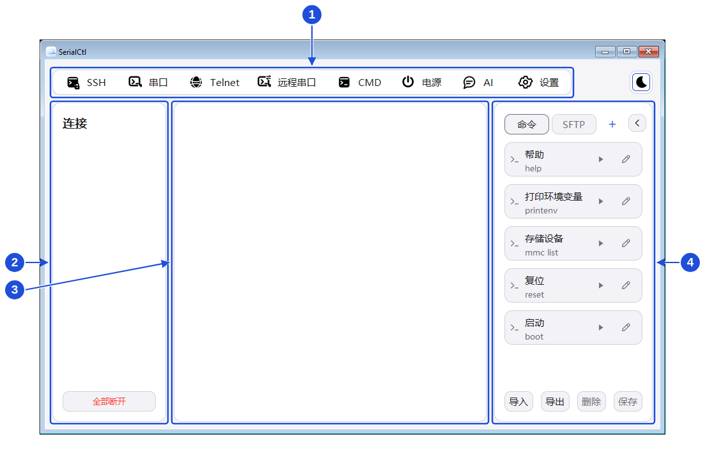

1. 在顶部选择需要的功能：SSH、串口、Telnet、远程串口、CMD 或 AI。
2. 建立连接后，在左侧“连接”列表中选择要操作的会话。
3. 在中间工作区查看输出、键入终端命令，或与 AI 对话。
4. 使用右侧“命令 / SFTP”区域执行常用命令或管理 SSH 文件。

**使用提示：**首次使用推荐：先建立终端连接，确认能够收到输出，再使用 AI 分析。

<a id="chapter-02"></a>

## 02　切换会话与断开连接

串口、SSH、Telnet、CMD 可同时保留多个会话。操作前先确认左侧当前选中的连接。

### 切换到正确的目标

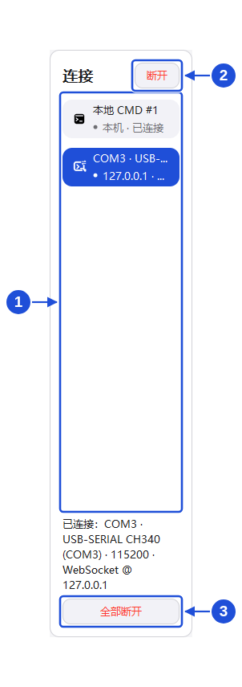

1. 点击左侧需要操作的连接卡片。
2. 确认中间终端已显示该会话的内容；需要结束当前连接时点击左上“断开”。
3. 需要结束本窗口全部连接时，点击左下“全部断开”。

**使用提示：**切换会话会保留各自的终端内容和查看位置。“全部断开”也会停止关联任务并关闭本地 CMD。

<a id="chapter-03"></a>

## 03　连接本地串口

先接好串口设备并安装其驱动，然后点击顶部“串口”。

### 选择设备与通信参数

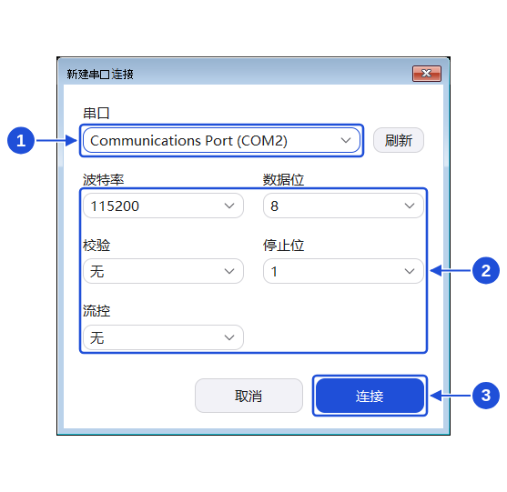

1. 在“串口”下拉框选择正确的设备；刚插入设备时可点击“刷新”。
2. 按照设备说明设置波特率、数据位、校验、停止位和流控。常见示例为 115200、8、无校验、1、无流控。
3. 点击“连接”，然后在左侧选中该串口，检查是否收到设备输出。

**操作结果：**连接成功后，中间终端显示接收到的数据。

**使用提示：**图中的 COM 号是截图环境中的设备。若显示“未检测到串口”，先检查连线、驱动及 Windows 设备管理器；端口被其他软件占用时，先关闭占用程序。

<a id="chapter-04"></a>

## 04　连接远程共享串口

来源电脑也需要运行 SerialCtl，并先通过“串口”打开要共享的本地 COM 口。本版仅发现 SerialCtl 自身共享的串口。

### 输入 IP，查询并连接

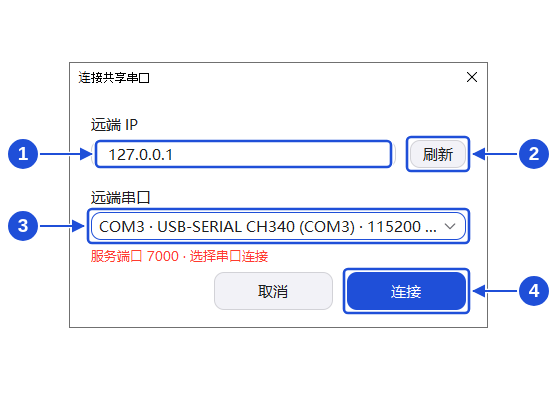

1. 点击顶部“远程串口”，在“远端 IP”填写来源电脑的实际 IP。
2. 等待自动查询，或点击“刷新”重新查询。
3. 在“远端串口”下拉框中选择对应硬件和 COM 口。
4. 点击“连接”，在终端检查远端输出。

**操作结果：**左侧出现该远程串口连接，可与其他会话切换。

**使用提示：**图中的 127.0.0.1 仅用于同机演示；连接另一台电脑时必须替换为那台电脑的 IP。不要填本机 IP 代替远端地址。

### 找到了多个实例时指定端口


1. 右键远程串口弹窗的“刷新”，打开“高级：指定服务端口…”后，填写来源 SerialCtl 的实际端口。
2. 点击“确定”，回到远程串口列表刷新，再选择串口并连接。

**使用提示：**通常使用自动发现即可，常见服务端口为 7000–7015。没有查询结果时，先确认来源 SerialCtl 和本地串口仍在运行，并检查两台电脑的网络与防火墙。

<a id="chapter-05"></a>

## 05　SSH 登录与主机身份核对

点击顶部“SSH”。准备好服务器地址、SSH 端口、用户名和密码。

### 填写 SSH 连接信息

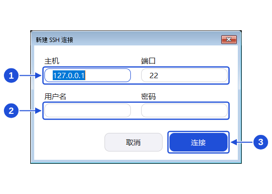

1. 填写服务器 IP 或域名，以及实际 SSH 端口，默认端口为 22。
2. 填写用户名和密码。
3. 点击“连接”。首次连接时，继续完成下一页的主机身份核对。

**使用提示：**密码修改后，重新连接并输入新密码。认证失败与主机身份变化是两类问题，不要通过删除指纹来处理密码错误。

### 首次连接核对指纹

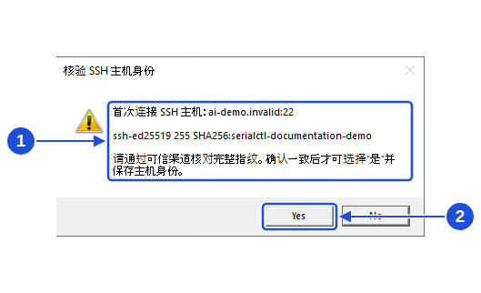

1. 查看弹窗中的主机地址和完整指纹。
2. 通过服务器管理员或可信记录核对指纹；一致时点击“是 / Yes”，否则点击“否 / No”。

**操作结果：**完成登录后，在终端输入命令并查看服务器回显。

**使用提示：**SSH 与 AI 首次连接都可能出现身份确认。本图以 AI 连接的真实身份提示为例。以前信任过的主机身份发生变化时，先联系管理员核实。

<a id="chapter-06"></a>

## 06　连接 Telnet

点击顶部“Telnet”。

### 填写目标地址与端口

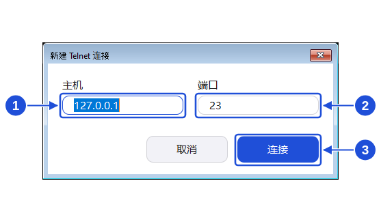

1. 填写目标设备的 IP 或域名。
2. 填写设备的 Telnet 端口；常见默认值为 23，按现场配置修改。
3. 点击“连接”，按终端提示输入登录信息，然后执行命令。

**操作结果：**登录提示和后续输出出现在中间终端。

<a id="chapter-07"></a>

## 07　使用本地 CMD

CMD 在当前电脑打开命令行会话，不是远程开发板终端。

### 打开并输入命令

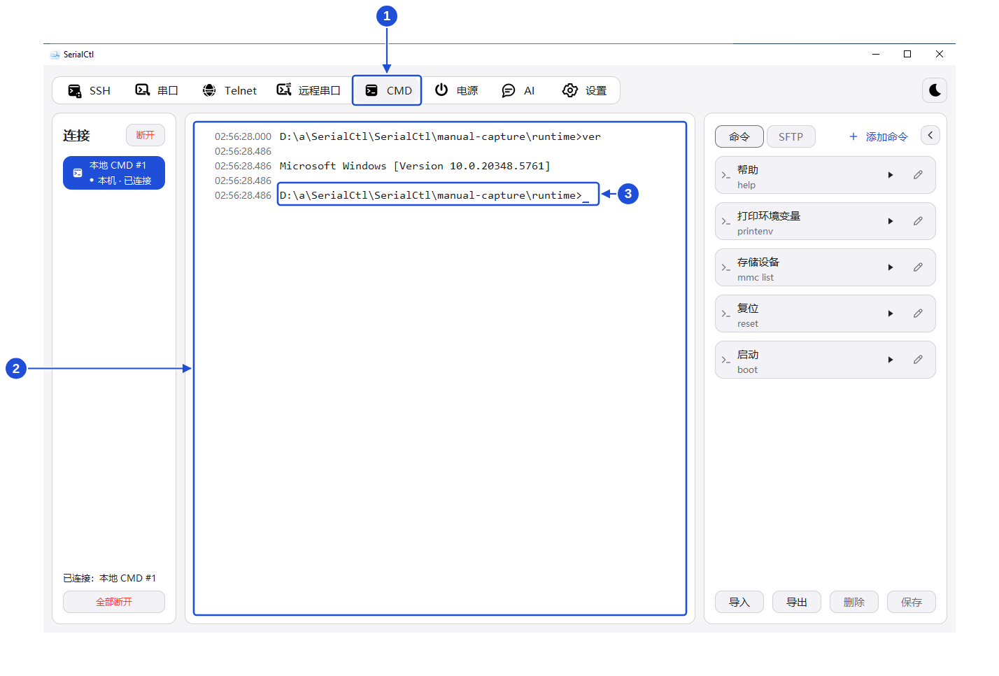

1. 点击顶部“CMD”。
2. 点击中间终端，在提示符后键入命令，例如 ver 或 dir。
3. 按 Enter 提交完整一行，在终端查看执行结果。

**使用提示：**同一个 CMD 会话会保留当前目录等状态。CMD 主要用于普通行命令，不适合作为全屏交互程序或 Ctrl+C 中断的替代终端。

<a id="chapter-08"></a>

## 08　终端输入、复制与历史查看

以下操作适用于串口、远程串口、SSH、Telnet 和 CMD；输入的命令应与目标系统相匹配。

### 直接在终端中操作

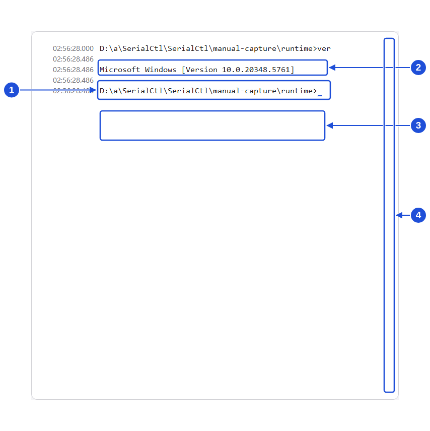

1. 点击终端后键入内容，按 Enter 发送；换行方式可在“设置”中调整。
2. 用鼠标拖选输出，松开后自动复制；双击可选中并复制一个词。
3. 在终端中右键点击可粘贴一次；需要执行时再按 Enter。
4. 滚动鼠标滚轮或拖动滚动条查看历史；主动输入或执行命令会回到实时位置。

**使用提示：**粘贴文本中如果已经带有换行，CMD 可能直接提交完整行。粘贴前先检查剪贴板内容。终端页面没有额外的底部消息输入框；AI 页面才有消息输入框。

<a id="chapter-09"></a>

## 09　常用命令：运行、编辑与保存

先选中正确终端，再操作右侧命令卡片。默认命令不一定适用于当前系统，例如 U-Boot 命令不能直接当作 Windows CMD 命令。

### 使用命令卡片

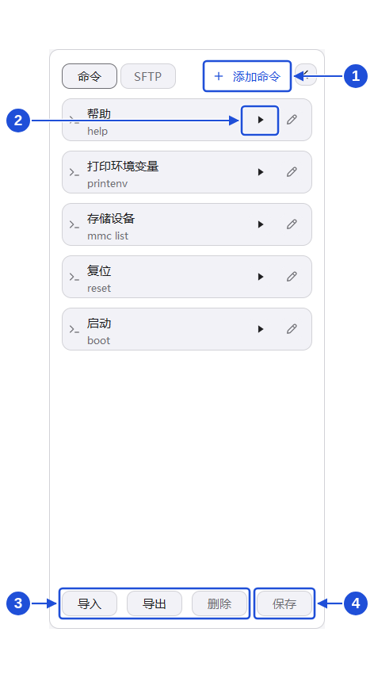

1. 点击“添加命令 / ＋”创建命令；修改已有命令时点击卡片右侧铅笔。
2. 确认当前终端正确后，点击卡片上的运行三角发送指令。
3. 需要备份或批量维护时，使用底部“导入”“导出”；选择卡片后可用“删除”。
4. 修改完成后点击底部“保存”；带星号时表示仍有未保存更改。

**使用提示：**命令提交后，以终端回显判断结果。需要调整顺序时，可拖动卡片左侧的命令标记。

### 添加一条指令

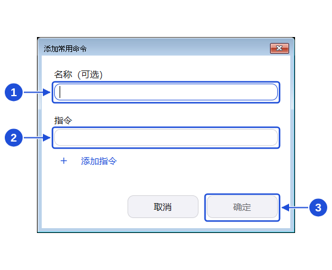

1. 填写便于识别的名称，名称可以留空。
2. 在“指令”中填写要发送的一行命令，例如 uname -a。
3. 点击“确定”，返回命令列表后点击“保存”。

**操作结果：**新命令出现在右侧列表，可直接点击运行。

<a id="chapter-10"></a>

## 10　多步命令与停止后续步骤

一张命令卡片最多可包含 10 条指令，按顺序提交。

### 设置步骤与间隔

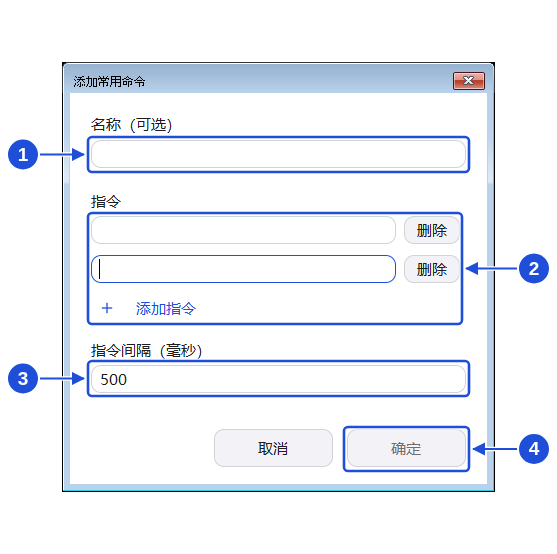

1. 在命令编辑弹窗中填写名称和第一条指令。
2. 点击“添加指令”增加下一步，逐行填写；不需要的步骤点击旁边“删除”。
3. 填写“指令间隔（毫秒）”，例如 500 表示相邻提交间隔约半秒。
4. 点击“确定”，返回后保存。运行该卡片时，可查看提交进度；需要取消后续步骤时点击卡片的停止操作。

**使用提示：**步骤多时可在弹窗内部滚动，底部确定 / 取消仍可见。停止只取消尚未提交的步骤，不会撤销已经发送的命令；间隔时间也不代表上一条命令已经执行成功。

<a id="chapter-11"></a>

## 11　SFTP 文件浏览与传输

先建立并选中 SSH 连接，再点击右侧“SFTP”。串口、Telnet 和 CMD 不提供此页的 SSH 文件管理能力。

### 浏览、上传和下载

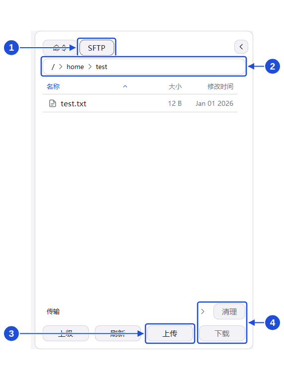

1. 点击“SFTP”，等待远端目录列表加载。
2. 点击路径面包屑切换上级目录；双击文件夹进入，或用“上级”“刷新”。
3. 点击“上传”选择本地文件；也可把本地文件拖到文件列表中上传。
4. 选中远端文件后点击“下载”，选择本地保存位置；展开“传输”查看进度、失败或取消状态。

**操作结果：**上传完成后刷新目录核对文件；下载完成后到所选本地位置检查。

**使用提示：**可多选文件。右键菜单提供新建文件夹、重命名、删除、复制路径、修改权限等操作；删除前核对远端目标。

### 直接打开远端目录

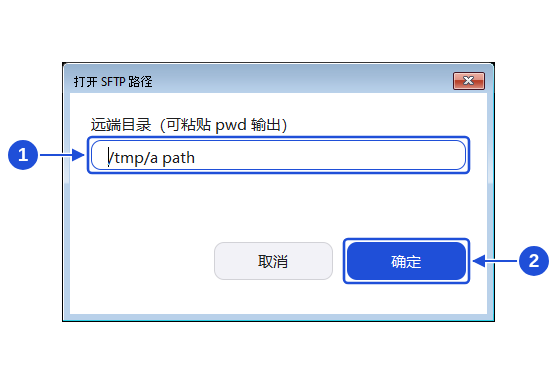

1. 从 SFTP 路径栏打开此弹窗后，输入 Linux 绝对路径，例如 /home/developer，或使用 ~/ 形式。
2. 点击“确定”，等待目录列表更新。

**使用提示：**终端中的 cd 与 SFTP 浏览目录不要混淆；以 SFTP 路径栏显示的目录为准。

<a id="chapter-12"></a>

## 12　设置：回显、时间戳、编码与换行

先选中目标会话，再点击顶部“设置”。弹窗会区分“全局”和“当前会话”。

### 调整显示与发送方式

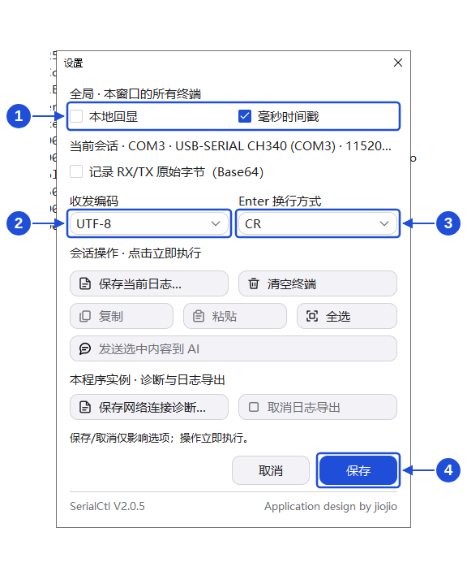

1. 按需要设置全局“本地回显”和“毫秒时间戳”。
2. 在“收发编码”选择与设备一致的编码；CMD 通常使用自动代码页。
3. 选择 Enter 的发送方式；串口常见 CR、LF 或 CRLF，应以目标设备要求为准。
4. 点击“保存”应用选项；仅想放弃选项更改时点击“取消”。

**使用提示：**如果字符乱码，先核对设备与客户端编码。底部“会话操作”按钮会立即执行，点击“取消”不会撤回已经执行的清空、保存日志或粘贴等操作。

<a id="chapter-13"></a>

## 13　保存日志与导出诊断

需要保存的是哪一个连接的日志，就先选中哪一个连接，再打开“设置”。

### 保存当前会话日志

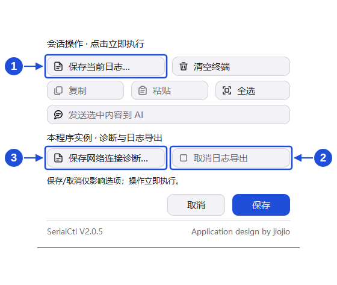

1. 点击“保存当前日志…”，在系统“另存为”窗口选择路径和文件名，保存为 .log 或 .txt。
2. 较大日志导出时等待完成提示；确需中止时点击“取消日志导出”。
3. 排查网络连接问题时，点击“保存网络连接诊断…”另存一份 JSON 文件交给维护人员。

**操作结果：**检查保存位置存在导出文件，并打开确认内容。

**使用提示：**日常会话日志也会保存在 %LOCALAPPDATA%\SerialCtl\logs\。RX/TX 原始字节记录只在需要核对收发数据时开启，日常使用一般不必勾选。

<a id="chapter-14"></a>

## 14　连接 AI 服务器

准备一台已经可正常使用 Codex 的 Linux 服务器及其 SSH 登录信息。Windows 端无需重复填写模型网关或 API Key。

### 填写连接信息并检测

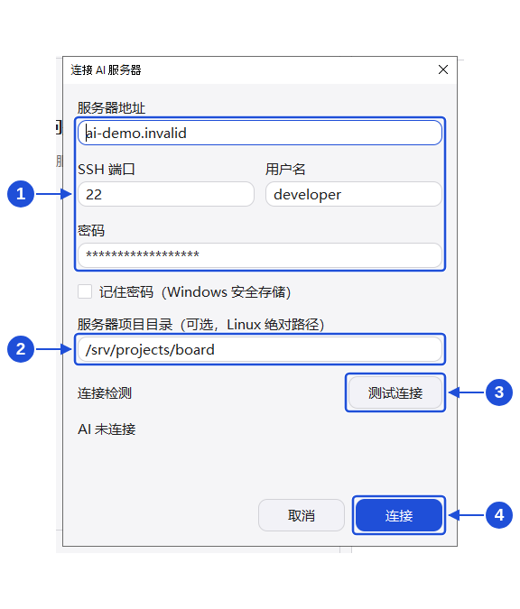

1. 点击顶部“AI”，填写服务器地址、SSH 端口、用户名和密码。
2. 可选填写“服务器项目目录”，使用 Linux 绝对路径；不需要时留空。
3. 点击“测试连接”；首次连接时按第 5 章核对主机指纹。
4. 检测成功后点击“进入对话”。密码默认不保存，需要时再勾选“记住密码”。

**使用提示：**图中的 ai-demo.invalid 是不可用于现场连接的演示域名，请替换为真实服务器信息。AI 使用服务器默认模型，当前界面不提供模型下拉选择。 测试成功后，右下角的“连接”会变为“进入对话”，点击该位置进入。

### 确认 AI 已就绪

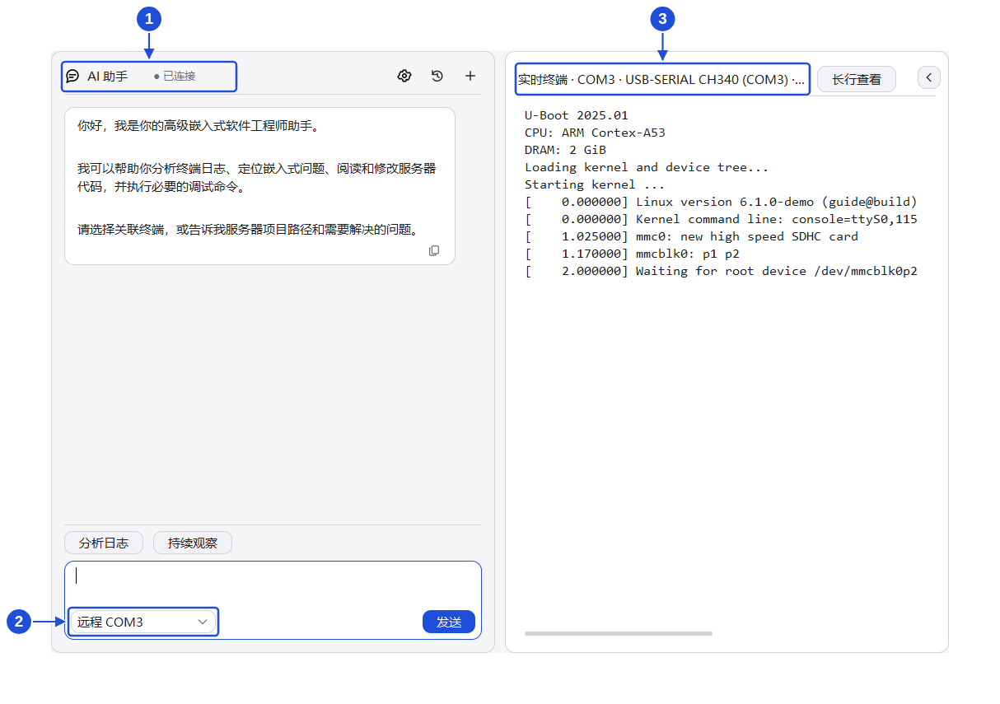

1. 确认 AI 页顶部显示“已连接”，对话区出现首次能力介绍。
2. 在输入栏的终端选择框中明确选择目标；也可选择“连接远程串口…”创建远程连接。
3. 确认右侧实时终端与目标一致，然后再发送任务。

**使用提示：**普通交流或分析服务器项目时可以不关联终端；需要读取或操作设备时必须明确选择正确目标。

<a id="chapter-15"></a>

## 15　让 AI 分析日志并执行诊断

发送任务前，先核对输入栏中的关联终端及右侧输出。

### 发起日志分析

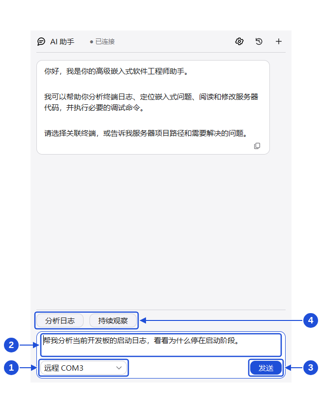

1. 选择目标终端，例如当前的远程 COM3。
2. 在消息输入框描述问题，例如“帮我分析当前开发板的启动日志，看看为什么停在启动阶段”。
3. 点击“发送”；也可用“分析日志”快速发起当前日志分析。
4. 在对话中阅读分析结论，需要跟踪新输出时使用“持续观察”。

**使用提示：**AI 输入框 Enter 发送，Shift+Enter 换行。需要只分析一段输出时，可先在终端选中它，再用 Ctrl+Shift+A 或“设置 → 发送选中内容到 AI”附加到草稿，检查后再发送。

### 要求 AI 提交一条诊断命令

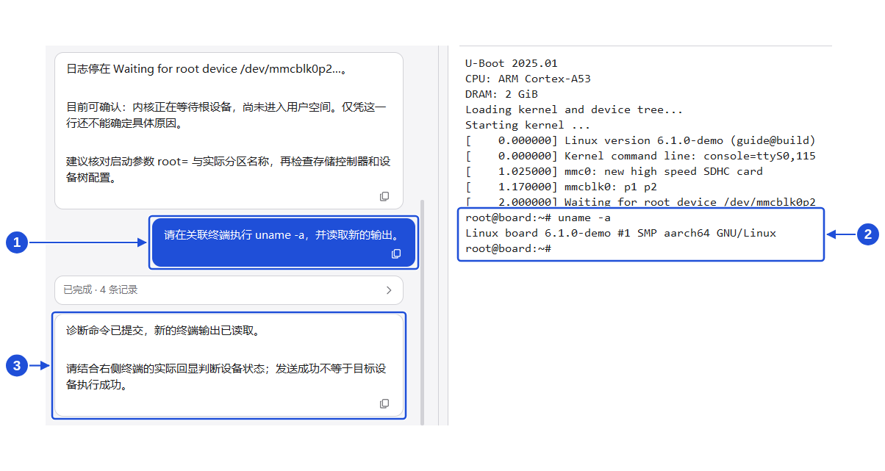

1. 在消息中写明要操作的目标和命令，例如“在关联终端执行 uname -a，并读取新的输出”。
2. 查看执行过程里显示的目标与命令，同时观察右侧终端回显。
3. AI 会读取后续输出继续回答；以实际回显判断命令结果。

**使用提示：**当前 AI 可以直接读取并向已关联终端发送指令，不会逐条再次确认。任务运行时如需终止，请使用独立的“停止”按钮；已提交到设备或服务器的操作可能仍会继续。

<a id="chapter-16"></a>

## 16　AI 实时终端与长行查看

AI 与右侧实时终端默认等分显示，可按阅读习惯调整。

### 边看对话边看终端

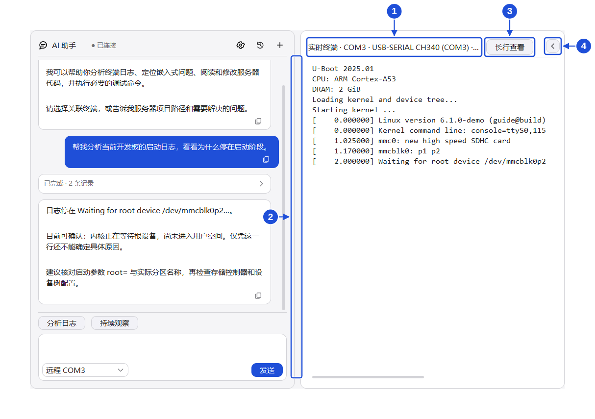

1. 确认右侧标题与需要观察的终端一致。
2. 拖动对话区与终端之间的分隔条调整比例；双击分隔条可恢复等分。
3. 长行超出视野时，拖动底部横向滚动条查看；用“长行查看 / 自动折行”切换阅读方式。
4. 点击右侧收起按钮隐藏终端，之后可从窄栏入口重新展开。

**使用提示：**实时终端默认不显示程序附加时间戳。这里展示的是所选终端的实际输出，不是 AI 的复述。

<a id="chapter-17"></a>

## 17　AI 过程折叠、历史会话与整理

执行期间显示详细过程。正常回答结束后，过程会自动收起，最终回答保持显示。

### 查看折叠记录与复制回复

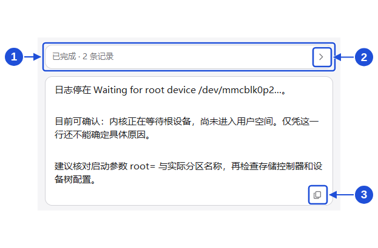

1. 回答结束后，可在最终回答前看到“已完成 · N 条记录”的过程摘要。
2. 需要细节时点击摘要或右侧箭头重新展开，再次点击可以收起。
3. 拖选 AI 回复文字、松开即可复制；也可点击消息卡片的复制图标复制整条消息。

**使用提示：**中间命令失败会在摘要中保留失败标记，展开仍能查看原始内容。整个任务失败或被停止时，过程保持展开。对话可上下滚动；阅读旧消息时新回复不会强制抢走位置。

### 恢复历史或整理当前对话

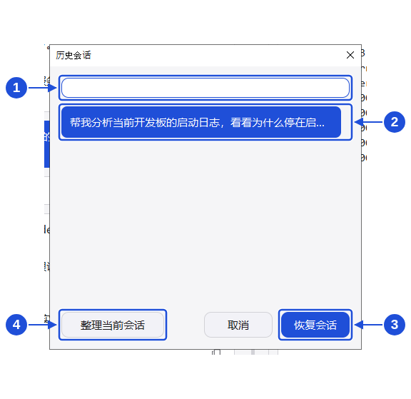

1. 点击 AI 顶部的历史图标，打开“历史会话”。
2. 在搜索框筛选记录，再选中需要的会话。
3. 点击“恢复会话”继续查看和交流；新问题需要独立上下文时，可在 AI 顶部点击“＋”新建会话。
4. 长对话需要整理时，重新打开历史弹窗，点击“整理当前会话”，等待服务器完成提示。

**使用提示：**恢复列表按当前服务器与账号显示。折叠执行过程只改变显示，不等于压缩模型上下文；自动整理是否可用取决于服务器，手动整理失败时原会话仍保留。

<a id="chapter-18"></a>

## 18　让 AI 处理服务器项目

服务器代码与开发板终端是两个不同目标。请在消息中说明是在服务器项目里操作，还是在关联终端里执行。

### 指定目录并描述修改任务

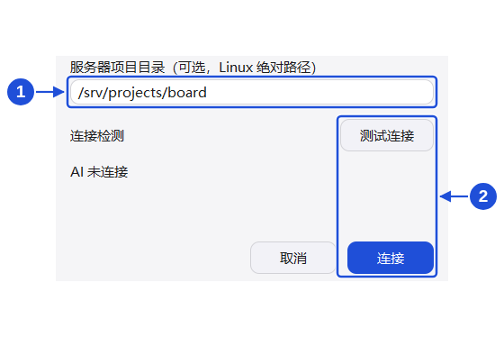

1. 连接 AI 前，在“服务器项目目录”填写项目的 Linux 绝对路径，例如 /srv/projects/board。
2. 测试连接并进入对话。按第 15 章的方法发送下面的项目任务示例，然后检查 AI 返回的路径、命令、文件修改和测试结果。

**使用提示：**项目目录必须对运行 AI 的服务器或容器可见，并且当前 SSH 账号有访问权限。已连接时字段会锁定；若要变更目录，先断开 AI，再打开连接设置修改并重连。

**可直接参考的填写 / 消息示例：**

> 请阅读 /srv/projects/board 项目，定位驱动初始化失败的原因，修改相关代码并运行测试，最后说明修改内容和测试结果。

<a id="chapter-19"></a>

## 19　主题与面板布局

可在浅色和深色主题之间切换，并调整工作区空间。

### 调整阅读界面

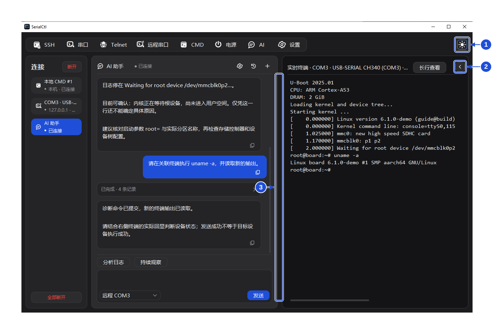

1. 点击右上角月亮 / 太阳按钮切换主题。
2. 使用右侧收起 / 展开按钮为终端或 AI 对话留出空间。
3. 拖动面板之间的分隔条调整宽度；拖动窗口边框改变整体大小。

**使用提示：**缩小窗口时部分顶部入口可能仅保留图标，悬停可查看名称。调整后仍应确认当前选中的连接和操作目标。

<a id="chapter-20"></a>

## 20　启动在线更新

程序启动时自动检查更新。下面以 V2.0.4 升级 V2.0.5 的真实提示为例，后续新版的操作步骤相同。

### 确认后开始下载

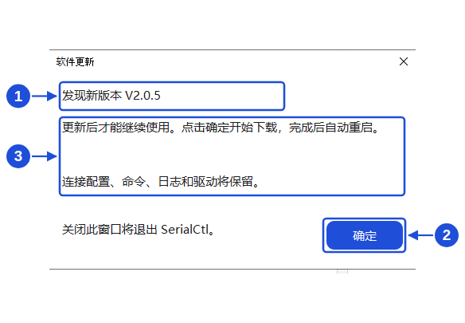

1. 看到可信新版本提示后，先确认提示中的目标版本。
2. 点击“确定”开始更新；关闭这个提示会退出软件。
3. 等待下载和校验完成，程序会在满足空闲条件时安装并自动重启。

**使用提示：**正确配置过更新地址的电脑不必每次重新填写。正在使用连接或执行任务时，先完成工作、断开连接，再在空闲时重启确认更新。

### 等待进度完成并检查版本

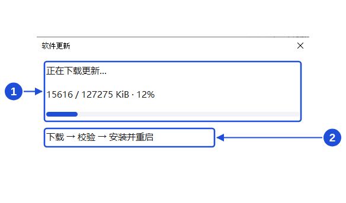

1. 在进度窗口等待下载、校验和安装，不要手动删除更新暂存文件。
2. 自动重启后，打开“设置”，在底部核对版本号。

**使用提示：**如果一直没有更新提示，请检查程序旁 update.ini 的地址，并联系管理员核对服务器文件。管理员每次只需上传配套 ZIP 和 update.json：先传完整 ZIP，再替换 update.json；ZIP 不解压、JSON 不手改。已有连接配置、命令、日志和驱动会保留。更新地址示例见本章下方。

**可直接参考的填写 / 消息示例：**

```ini
[update]
url=http://172.16.3.188/external/serial/update.json
```

<a id="chapter-21"></a>

## 21　电源页面：当前版本状态

点击顶部“电源”可打开电源页面。V2.0.5 的真实电源连接暂未开放。

### 识别暂未开放提示

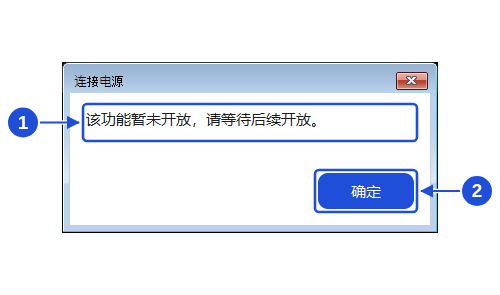

1. 在电源页点击“连接”后，若出现此提示，说明当前版本尚未开放设备连接。
2. 点击“确定”关闭提示，需要继续工作时从顶部或左侧切回串口、SSH 或 AI。

**使用提示：**当前版本不要把页面上预留的参数和控制按钮当作已经可用的硬件操作。AI 也不能通过此版本建立电源连接。

<a id="appendix-a"></a>

## 附录 A：常用操作速查

| 操作 | 作用 |
|---|---|
| 在终端键入内容后按 Enter | 向当前连接提交输入；具体换行方式见“设置”。 |
| 终端拖选后松开 / 双击一个词 | 自动复制所选内容 / 复制该词。 |
| 终端右键 | 粘贴一次；剪贴板自带换行时可能直接提交完整行。 |
| AI 输入框 Enter / Shift+Enter | 发送消息 / 在消息内换行。 |
| 文本输入框 Ctrl+A | 选择输入框全部文本。 |
| Ctrl+Shift+A | 将终端中选中的内容附加到 AI 草稿，检查后再发送。 |
| 鼠标滚轮 / 拖动滚动条 | 查看终端或 AI 历史内容。 |
| Ctrl+F6 / Ctrl+Shift+F6 | 在可见窗格之间向前 / 向后移动键盘焦点。 |
| AI 页面分隔条双击 | 恢复 AI 对话与实时终端等分。 |

<a id="appendix-b"></a>

## 附录 B：常见问题

| 现象 | 用户可以先做什么 |
|---|---|
| 没有检测到本地串口 | 检查设备供电、连线和驱动；确认 Windows 设备管理器中存在 COM 口，再点击刷新。 |
| 串口无法打开 | 关闭占用该端口的其他串口工具，确认端口号和通信参数，再重试连接。 |
| 远程串口列表为空 | 确认来源电脑运行 SerialCtl，且已经打开本地串口；检查实际 IP、网络和防火墙。多实例时指定服务端口。 |
| 终端乱码或 Enter 没反应 | 核对收发编码、波特率、校验、流控及 CR / LF / CRLF；设备本身未就绪时也可能没有回显。 |
| SSH 提示认证失败 | 检查用户名和新密码后重新登录；不要为解决密码错误而删除主机指纹。主机身份改变时联系管理员核对。 |
| SFTP 无法使用 | 先选中正常登录的 SSH 连接，再进入 SFTP；串口、Telnet、CMD 不具备 SSH 文件管理页。 |
| AI 不能读取终端 | 确认终端仍连接，并在 AI 输入栏明确关联；核对右侧标题是否为同一会话。 |
| AI 连接异常或任务中断 | 按提示检查服务器登录、Codex 服务和目录权限；重连后通过历史恢复，不要盲目重发已经提交的设备命令。 |
| 命令已点击但设备没有执行结果 | 提交仅代表指令已经送出或排队，查看实际终端回显；必要时核对设备状态和换行设置。 |
| 没有收到更新提示 | 检查 update.ini 的完整 update.json 地址；让管理员确认更高版本的 ZIP 与签名清单已经正确上传。 |

---

本手册对应 SerialCtl V2.0.5。电源连接在此版本暂未开放；后续版本界面或功能发生变化时，请以对应版本的手册为准。
